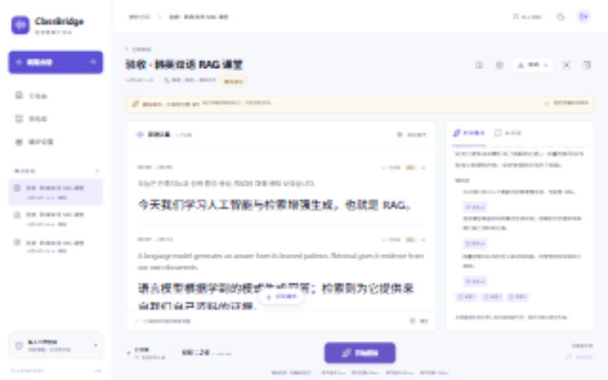

# ClassBridge · 语音理解工作台

面向韩英交替课堂、会议和访谈的私人语音理解应用。React / TypeScript / Vite 前端，FastAPI 后端，生产使用 PostgreSQL + pgvector、Redis / Celery、Nginx。项目独立放在 `classbridge/`，不覆盖其他网站。

**当前交付：本地模拟链路已运行并验收；2026-11-01已通过真实ASR的200毫秒静音任务和单词MT请求，尚未验证真实课堂效果；Docker配置已提供，但本机没有可用Docker Engine，不能声称容器启动成功。** 最新云接口验证见 [模型兼容记录](docs/MODEL_COMPATIBILITY.md)，完整状态见 [功能清单](docs/FEATURE_STATUS.md) 与 [测试记录](docs/TEST_RESULTS.md)。

后续用户真实会话已保存约42分钟音频和242条原文记录，但发生运行中断流，不能据此认定长课堂稳定性通过。2026-11-01已补充准备握手、音频转发调度、发送失败监测与安全诊断；更新后重启后端并刷新页面，排查方法见 [实时录音中断排查](docs/REALTIME_TROUBLESHOOTING.md)。

## 当前本地入口

手动使用 `npm run dev` 时，当前前端配置端口为80，访问 **http://localhost/**；下面的5173入口对应 `deploy/start-local.ps1`，该脚本显式指定5173。后端均为8000，两种前端启动方式不必同时使用。

- 应用：<http://127.0.0.1:5173>
- 接口文档：<http://127.0.0.1:8000/api/docs>
- 健康检查：<http://127.0.0.1:8000/api/health>
- 此工作目录的本地管理员账户保存在 `.local/credentials.txt`（已排除版本控制）。生产没有默认密码，必须通过服务器命令初始化。

本地服务在当前电脑运行；关闭电脑后本地入口不可用。部署到服务器后，手机和平板可直接通过服务器 HTTPS 域名使用，无需个人电脑保持开机。本次没有公网地址。

## 三步体验模拟模式

1. 打开本地入口并登录；如服务已停止，在项目根目录运行 `./deploy/start-local.ps1`。
2. 点击「新建课堂」，保留「模拟演示」，创建后点击「开始模拟」。不请求麦克风、不调用付费 API，字幕带模拟标记。
3. 点击停止，查看阶段重点，进入 AI 问答提问并点击来源，或使用导出菜单；刷新后字幕仍在。已保留名为「验收 · 韩英双语 RAG 课堂」的测试样本和讲义，方便直接检查。

## 从源码启动

使用现有环境在PyCharm运行、打断点和排查启动问题，请看 [PYCHARM_DEBUG.md](docs/PYCHARM_DEBUG.md)。项目 `.run/` 提供迁移和后端测试配置；API可直接右键运行或Debug下述入口。

后端可直接右键运行或Debug `backend/main.py`，入口使用 `if __name__ == "__main__"`，当前默认监听0.0.0.0:8000（所有网卡），本机访问地址仍是127.0.0.1:8000。仅需本机监听时传入 `--host 127.0.0.1`。在项目根目录运行 `.venv/Scripts/python.exe backend/main.py` 效果相同。入口自动将工作目录固定为backend，读取根目录.env并复用现有数据库。前端仍单独执行 `npm run dev`。

要求 Python 3.11+、Node.js 22+。Windows 本次实际使用 Python 3.13、Node.js 24；生产容器使用 Python 3.12、Node.js 22 构建。依赖通过 `package-lock.json` 和 `backend/requirements.lock.txt` 约束。

```powershell
# 在 classbridge/ 下，首次安装并交互设置至少12字符的管理员密码
./deploy/start-local.ps1 -Install -Initialize
# 后续启动 / 停止
./deploy/start-local.ps1
./deploy/stop-local.ps1
```

`-Install` 需要 Python Launcher (`py`)；没有 Launcher 时可先用完整 Python 路径执行 `python -m venv .venv`，然后再运行脚本。首次初始化已有同名账号会拒绝覆盖。重设密码须显式运行 `python -m app.cli create-admin --username admin --reset-password`，此命令会撤销该账号旧登录。

Linux 开发首次运行 `bash deploy/start-local.sh --install --initialize`，后续运行 `bash deploy/start-local.sh`，Ctrl+C停止服务。开发默认 SQLite + 数据库 outbox 本地执行器，便于没有 Docker 的电脑验证；这不是生产数据库替代方案。生产配置强制 PostgreSQL 和 Celery。

## 安全配置真实模式

iPad/iPhone通过VPN访问并使用麦克风，需要浏览器信任的HTTPS。当前Tailscale方案及管理员启用步骤见 [VPN_HTTPS.md](docs/VPN_HTTPS.md)。HTTP的VPN IP地址仍不满足麦克风安全上下文要求。

在服务器复制 `.env.example` 为 `.env`，使用受控编辑器或服务器密钥管理配置：

```dotenv
DASHSCOPE_API_KEY=在服务器填写实际值
DASHSCOPE_WORKSPACE_ID=北京地域实际业务空间ID
DASHSCOPE_REGION=cn-beijing
```

不要把真实密钥发到聊天、输入网页、提交 Git 或放入任何 `VITE_` 变量。密钥只由 API/worker 读取。修改后重启两个服务。网页设置仅显示「是否配置」，不显示密钥，也不把配置完成当成模型测试通过。管理员还须确认同地域模型授权、额度和业务空间权限。

生产必须同时配置随机 `SECRET_KEY`、`POSTGRES_PASSWORD`、`COOKIE_SECURE=true`、HTTPS `ALLOWED_ORIGINS` 与 `PUBLIC_BASE_URL`。具体模型、地域地址、认证及官方协议依据见 [MODEL_COMPATIBILITY.md](docs/MODEL_COMPATIBILITY.md)。先进行10–20秒韩英短样本验收，再开始完整课堂；真实错误不会自动换成模拟字幕。

## 功能与代码

| 目录 | 内容 |
| --- | --- |
| `frontend/src/components` | 首页、实时会话/历史详情、资料库、设置、引用预览 |
| `frontend/src/lib` | API、事件版本合并、WebSocket、麦克风生命周期 |
| `frontend/public/audio` | AudioWorklet、单声道16kHz PCM重采样 |
| `backend/app/api` | 私人认证、会话/资料/问答/导出接口 |
| `backend/app/ws` | 本站WebSocket、音频流、缺口与恢复 |
| `backend/app/providers` | 阿里云原生协议和错误转换 |
| `backend/app/services` | 事务事件、检索/引用、解析、存储、PDF |
| `backend/app/models` / `schemas` | SQLAlchemy业务表、输入验证 |
| `backend/app/workers` | Celery、本地outbox、有限重试、音频到期删除 |
| `backend/migrations` | Alembic迁移及冻结的初始结构 |
| `deploy` | Docker、Nginx、启动/备份/恢复/集成验收脚本 |
| `docs` | 模型依据、复用说明、部署、接口、验收、实际截图 |

浏览器连续发送20ms音频帧，停止时先释放麦克风再收尾上游；105分钟是应用限制，不是费用上限。临时字幕不进入知识索引。稳定字幕、事件与待处理任务在同一事务提交，旧版本不能覆盖新定稿。刷新恢复保存记录，不自动开麦。

RAG 使用原文与文档块，SQL权限过滤后进行关键词/向量混合召回、去重、重排和引用校验。模拟问答明确显示本地证据摘录；真实模式才使用云端向量、重排和回答模型。PDF/PPTX按页/幻灯片引用；DOCX按段落/表格/字符位置引用，不虚构分页。扫描件暂不支持OCR，会显示限制。

## 测试

```powershell
Push-Location backend
../.venv/Scripts/python.exe -m pytest -q
Pop-Location
Push-Location frontend
npm test
npm run build
Pop-Location
# 已启动服务、有本地验收凭据时；只使用模拟模式，不调用付费API
.venv/Scripts/python.exe deploy/smoke_local.py
```

集成脚本生成自己的「验收」会话和小讲义，不清空已有用户数据。结果写入已忽略的 `test-results/`。数据库迁移、备份与恢复操作见 [部署说明](docs/DEPLOYMENT.md)。接口契约见 [API.md](docs/API.md)。

## 前端来源与许可

前端现代化第一阶段的组件、依赖、兼容性、45 项测试及实际浏览器响应式截图见 [FRONTEND_PHASE1_REDESIGN.md](docs/FRONTEND_PHASE1_REDESIGN.md)。手机与 iPad 截图为浏览器指定视口验收，不代表实体 Safari 已验证。

实际读取并采用 [Minomeet](https://github.com/shareefmx/minomeet) commit `2cfd93d6dc098fe0aa7c7f92cc8f4ce55fb0975b`。复用其 React/Vite/TypeScript/Tailwind 构建基础、依赖组合及CSS基础，沿用侧栏/卡片/录音/笔记/设置的信息结构；涉及原业务状态、录音和模型配置的页面实现已重写。没有声称原页面组件未经修改直接复用。详见 [FRONTEND_REUSE.md](docs/FRONTEND_REUSE.md)。

Minomeet MIT 版权声明保留在 `vendor/MINOMEET_LICENSE`、`frontend/LICENSE.minomeet` 与根 `LICENSE`。没有引入 assistant-ui：本版聊天较小，自定义后端与一套聊天状态足够，不依赖托管订阅。第三方依赖各自遵循其许可证。




