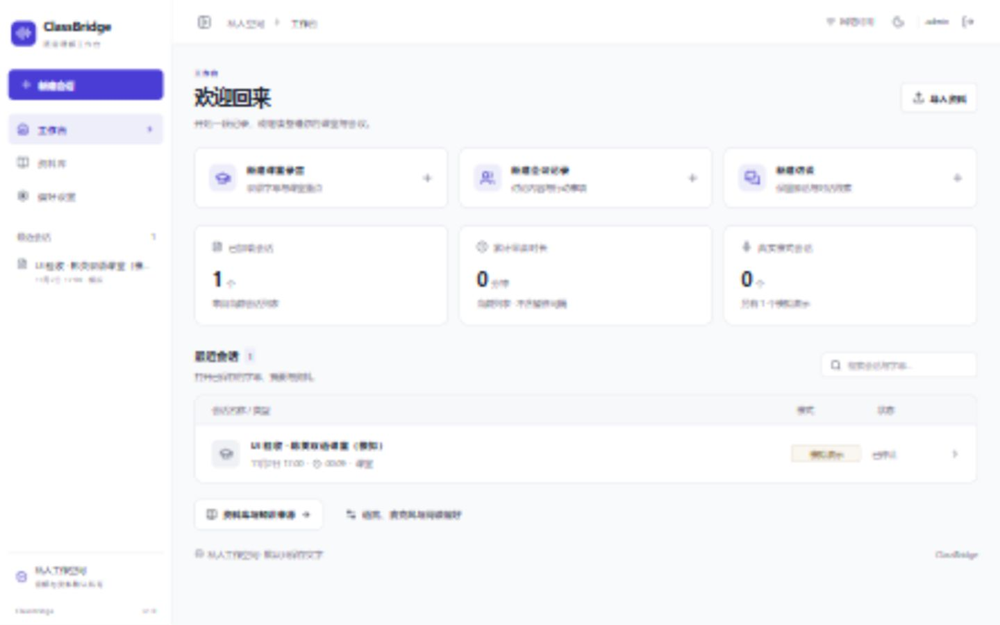
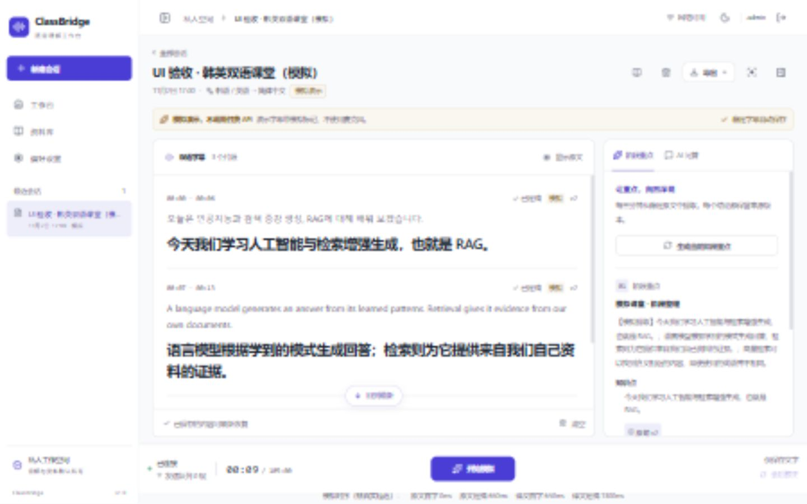
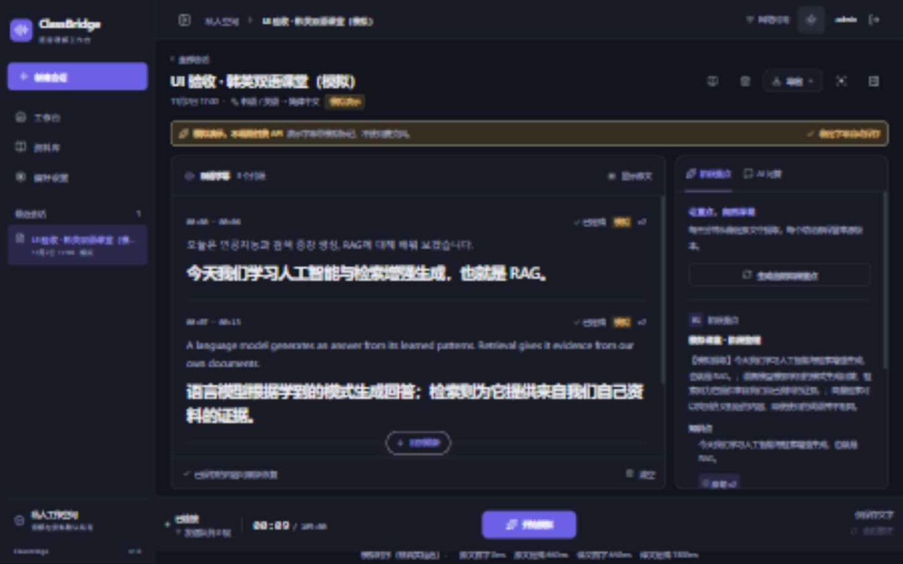

# ClassBridge 前端现代化重构 · 第一阶段交付

实施与验收：2026-11-02 至 2026-11-03（Asia/Seoul）。本报告仅覆盖前端现代化第一阶段，不代表真实语音识别准确率、生产部署或整个项目的重新验收。

## 1. 代码修改摘要

修改直接应用到现有 `frontend/` React 项目。保留 Hash 路由和现有业务接口。下表路径相对于 ClassBridge 根目录。

| 文件 | 修改作用 |
| --- | --- |
| `frontend/package.json` | 加入 Radix Dialog、clsx 和 DOM 交互测试依赖，保留原有构建和测试命令 |
| `frontend/package-lock.json` | 锁定依赖及其传递依赖 |
| `frontend/src/App.tsx` | 接入响应式导航、折叠状态、真实浏览器网络状态；为会话详情请求添加导航版本校验；录音时阻止 Hash 路由离开当前会话 |
| `frontend/src/components/Shell.tsx` | 可折叠桌面侧栏、移动抽屉、顶部路径/主题/账户操作；保留录音期间导航与退出限制 |
| `frontend/src/components/Home.tsx` | 工作台创建入口、当前列表统计、最近会话、搜索；新建表单使用共享 Dialog，保留原有提交字段 |
| `frontend/src/components/SessionView.tsx` | 字幕滚动区增加键盘焦点和区域名称；麦克风设置改为可展开区；录音控制增加可访问名称，其他调整由 CSS 实现 |
| `frontend/src/components/Library.tsx` | 上传、搜索及资料卡使用共享组件；隐藏原生文件输入的无意义焦点入口，保留原有上传和轮询逻辑 |
| `frontend/src/components/Settings.tsx` | 按五组展示全部原有设置；共享按钮/卡片/输入；保留草稿、课堂预设和显式保存 |
| `frontend/src/components/ui/button.tsx` | 支持原生属性、ref、禁用态和 primary/secondary/ghost/destructive 变体 |
| `frontend/src/components/ui/card.tsx` | 共享卡片容器 |
| `frontend/src/components/ui/input.tsx` | 原生 Input/Textarea 包装，保留属性和 ref |
| `frontend/src/components/ui/badge.tsx` | 共享模式/状态标签 |
| `frontend/src/components/ui/dialog.tsx` | Radix 模态层、标题关联、焦点约束、Escape、忙碌关闭限制及关闭后的焦点恢复 |
| `frontend/src/lib/utils.ts` | clsx 驱动的 `cn` 类名组合函数 |
| `frontend/src/style.css` | 改为分层样式导入入口，移出原来的大块页面样式 |
| `frontend/src/upstream.css` | 保留 Tailwind 指令、实际使用的动画和 Minomeet 版权注释；清理未使用的旧全局规则 |
| `frontend/src/styles/tokens.css` | 明暗两套语义变量和旧 `--cb-*` 兼容别名 |
| `frontend/src/styles/base.css` | 基础字体、表单、焦点和通用布局规则 |
| `frontend/src/styles/components.css` | 共享控件、弹窗、状态提示、空态等 |
| `frontend/src/styles/layout.css` | Shell、侧栏、抽屉、顶部栏及相应断点 |
| `frontend/src/styles/pages/home.css` | 工作台创建卡、统计和会话列表 |
| `frontend/src/styles/pages/login.css` | 从原样式中迁移登录页规则 |
| `frontend/src/styles/pages/session.css` | 字幕主区域、辅助侧栏、专注模式、移动页签及底部录音栏 |
| `frontend/src/styles/pages/library.css` | 资料库页面样式 |
| `frontend/src/styles/pages/settings.css` | 设置分组、输入和模型状态样式 |
| `frontend/tailwind.config.js` | 映射语义颜色及圆角，保留 Tailwind 3 |
| `frontend/tests/uiInteraction.test.ts` | 新增 12 项实际 React DOM 交互测试，不删除原有 33 项测试 |
| `vendor/SHADCN_ADMIN_LICENSE` | 保存 Shadcn Admin MIT 原始版权和许可声明 |
| `README.md` | 增加本次重构报告入口 |
| `docs/FRONTEND_PHASE1_REDESIGN.md` | 本交付报告 |
| `docs/screenshots/frontend-phase1-*.jpg` | 本次实际浏览器截图，完整清单见第 6 节 |

本提交没有修改 `backend/`、AudioWorklet、音频采集、重采样、WebSocket 控制器、事件合并器、API 协议、模型、RAG 或数据库。既有 ASR 工作保留在基线提交中，未混入本次 UI 差异。

## 2. 新 UI 架构

`App` 仍持有登录、页面和会话状态；`ResponsiveSidebar` 只切换导航树。切换屏幕尺寸、字幕/摘要/问答页签、专注阅读和辅助侧栏不会改变 `SessionView` 的会话 key，也不会为这些操作创建新音频连接。桌面侧栏和移动抽屉同时只挂载一个导航树。

`tokens.css` 是颜色的唯一主题来源：background、foreground、card、primary、secondary、muted、accent、border、input、ring、destructive，以及 warning/info/success/error。旧 `--cb-*` 引用映射至同一套变量，避免旧组件与新组件维护两套颜色。CSS 通过入口按 tokens → base → components → layout → pages 加载；页面规则在所属文件修改，未在尾部另加整套全局覆盖。

Dialog 由 Radix 提供模态行为，业务提交状态仍属于调用页面。特别处理了“移动抽屉打开新建表单”：关闭的抽屉不能把焦点从新表单夺走；关闭最后一个弹窗后回到触发按钮，已卸载触发按钮则回到菜单按钮。提交期间禁止重复提交和关闭，失败后保留输入以便重试。

保留原 Hash 路由。新增导航版本校验，防止较早的详情 HTTP 请求返回后覆盖用户已经打开的资料库等页面；录音期间浏览器返回造成的 Hash 改变会恢复为当前会话。

### 上游来源与许可证

实际查看 [Shadcn Admin 固定版本](https://github.com/satnaing/shadcn-admin/tree/e16c87f213a5ba5e45964e9b67c792105ec74d26) 的 LICENSE、package.json、侧栏、header 和 main 源码。记录 commit：`e16c87f213a5ba5e45964e9b67c792105ec74d26`，版权 `Copyright (c) 2024 SatNaing`，MIT。

采用其管理工作台布局和主题组织思路，在现有 React 18 项目中实现适配组件；没有复制整个仓库。上游当时采用 React 19 / Tailwind 4，不直接移植其依赖、路由、数据层和无关管理模块。语义主题参考 [shadcn/ui Theming](https://ui.shadcn.com/docs/theming)。本项目的基础组件是兼容现有样式和业务的本地实现，不宣称未经修改使用了全部上游组件。

Minomeet 现有许可文件及源码归属注释保留；其历史来源见 [FRONTEND_REUSE.md](FRONTEND_REUSE.md)。

## 3. 依赖变化

| 包 | 新增固定版本 | 用途与兼容性 |
| --- | --- | --- |
| `@radix-ui/react-dialog` | 1.1.15 | 模态表单和移动抽屉；其 peer dependencies 包含 React 18 |
| `clsx` | 2.1.1 | 小型类名组合工具，不引入框架或状态容器 |
| `happy-dom`（开发） | 21.0.4 | Node 测试中的 DOM 环境；要求 Node >=20，本次 Node 24 环境通过 |

保留 React 18.3.1、TypeScript 5、Vite 6（本次安装版本 6.4.5）、Tailwind 3、Lucide 和 `node:test + tsx`。没有增加 React 19、Tailwind 4、TanStack Router/Query、Redux、assistant-ui 或第二套聊天状态。

开发测试依赖曾发现审计问题，升级至上述 happy-dom 版本后再验收；最终生产依赖 `npm audit --omit=dev` 为 0 个漏洞。新环境先执行 `npm ci`，不要复用缺少新依赖的旧 node_modules。Node 18 不能直接运行这一版 DOM 测试。

## 4. 页面结果与运行方式

| 页面/布局 | 完成结果 |
| --- | --- |
| 工作台 | 课堂/会议/访谈创建、搜索、最近会话、资料和设置入口；统计来自当前加载列表，明确标注范围及模拟数量 |
| 实时会话 | 桌面字幕约占主内容 70%，摘要/问答共享辅助栏；保留隐藏原文、专注、回到最新、导出、资料和会后校正入口 |
| 资料库 | 共享上传/搜索/资料卡；保留格式/大小限制、索引模式、扫描件提示、预览和删除逻辑 |
| 偏好设置 | 外观与阅读、语言与专业术语、录音与麦克风、音频与隐私、模型状态五组；课堂预设先改草稿，再由用户保存 |
| 桌面 | 可折叠固定侧栏；折叠后图标仍有名称和原生提示；顶部显示当前页面、浏览器网络状态、主题和账户 |
| iPad | 横屏双栏；竖屏切换抽屉导航和字幕/摘要/问答页签，不同时挤入三个面板 |
| 手机 | 单列页面、菜单抽屉、字幕页签、紧凑录音栏和 safe-area；长标题截断，弹窗可滚动 |

顶部“网络可用”只描述浏览器 online 状态，不表示阿里云或 WebSocket 已连接。录音栏仍显示实际实时连接状态。模拟字幕、阶段内容和延迟继续明确标记为模拟。

### 使用现有开发环境

后端继续使用原来的 PyCharm 配置或现有启动方式；本阶段没有新增迁移和模型配置。前端在 `classbridge/frontend` 执行：

```powershell
npm ci
npm run dev
```

现有 Vite 配置监听 80 端口，入口为 `http://localhost/`，`/api` 和 `/ws` 代理到 `127.0.0.1:8000`。如果 80 已由现有 Vite 占用，不要再启动第二个实例；先停止对应旧前端后再运行。Tailscale/HTTPS/Origin 配置继续沿用已有部署，不因本次 UI 更改自动生效。

本次验收使用额外的 `http://127.0.0.1:8011/`：生产前端构建 + 原有 FastAPI + 独立临时 SQLite，服务仅监听本机。验收进程清空了自身的 DASHSCOPE_API_KEY，未修改用户 `.env`、真实数据库或 8000 服务。该地址是本次本地验收入口，非公网部署。已登录的验收浏览器保留供查看，进程退出后该入口不可用。

三步模拟检查：①新建课堂，选择“模拟演示”；②点击“开始模拟”，切换辅助面板观察字幕；③停止后刷新，确认稳定字幕恢复且没有自动开始采集。

## 5. 测试结果

最终代码检查于 2026-11-03 执行，工作目录 `classbridge/frontend`：

| 命令 | 实际结果 |
| --- | --- |
| `npm test` | **45 通过，0 失败，0 跳过**，包含原有 33 项和新增 12 项 |
| `npm run typecheck` | 退出码 0，无类型错误 |
| `npm run build` | 退出码 0，Vite 6.4.5，2121 modules；最终构建 3.59 秒 |
| `npm audit --omit=dev` | 0 vulnerabilities |
| `git diff --check`（仓库根目录） | 通过；Windows LF/CRLF 提示不属于空白错误 |
| `git diff --stat` / 受保护目录差异核对 | 已执行；后端和音频/实时控制器无本次修改 |

构建产物：CSS 58.52 kB（gzip 11.94 kB），JS 291.79 kB（gzip 92.92 kB）。Dialog 可访问性增加了一些 JS 体积，未引入整套管理后台依赖。

新增测试覆盖：抽屉与表单焦点交接、表单失败重试/忙碌状态、资料轮询清理、侧栏导航和录音锁定、顶部网络/主题/退出、真实列表统计与创建参数、设置草稿显式保存、上传入口和限制、响应式导航监听清理、字幕面板切换不重建 socket、迟到详情响应淘汰、录音时 Hash 导航保护。原有重采样、设备释放、重连、乱序/版本、字幕和建议测试均继续执行。

实际浏览器使用本机 Chromium 内核和隔离服务：创建模拟会话 → 开始模拟 → 隐藏/显示侧栏 → 停止 → 刷新恢复三条双语稳定字幕。浏览器验证了录音时导航禁用、移动抽屉进入设置、设置预设保存、资料空态、AI 问答页签、新建弹窗焦点与 Escape、键盘滚动历史和回到最新、浅深主题。没有用 DOM 测试冒充实体 Safari 或真实音频验收。

## 6. 浏览器截图

下表为实际运行截图，来自浏览器捕获的 JPEG（有压缩），不是设计稿。所有会话数据明确为模拟。逻辑视口与图片像素可能因截图缩放取整相差 1 px。

| 逻辑视口 | 页面与截图 | 验证结果 |
| --- | --- | --- |
| 1440×900 | [工作台](screenshots/frontend-phase1-home.jpg)、[字幕](screenshots/frontend-phase1-desktop.jpg)、[暗色](screenshots/frontend-phase1-dark.jpg) | 无横向溢出；字幕区约 788 px 宽；底部控制可见 |
| 1280×800 | [笔记本](screenshots/frontend-phase1-laptop.jpg) | 字幕滚动区约 317 px 高，录音栏在视口内 |
| 1024×768 | [iPad 横屏尺寸](screenshots/frontend-phase1-ipad-landscape.jpg) | 双栏，字幕约 508 px 宽，无横向溢出 |
| 768×1024 | [iPad 竖屏尺寸](screenshots/frontend-phase1-ipad-portrait.jpg) | 抽屉导航与页签；字幕约 734 px 宽 |
| 390×844 | [手机](screenshots/frontend-phase1-mobile.jpg)、[新建弹窗](screenshots/frontend-phase1-mobile-dialog.jpg) | 字幕滚动区约 210 px 高；弹窗在视口内；截图高度 843 px |
| 360×800 | [小屏手机](screenshots/frontend-phase1-small-mobile.jpg) | 无横向溢出，录音控制可见 |
| 1440×900 | [资料库](screenshots/frontend-phase1-library.jpg) | 上传入口、模式、搜索和空态可见 |
| 1440×900 | [偏好设置首屏](screenshots/frontend-phase1-settings.jpg) | 截图展示首屏；五组设置通过 DOM 和交互检查，容器可纵向滚动 |







## 7. Git 状态

分支：`codex/frontend-phase1`。从工作区干净的既有提交 `3bb037d8a286bb549be720c7956bf6adcc25af59` 创建，原分支为 `feature/asr-classroom-audio`。UI 修改独立提交；没有合并到 main，也没有推送或强制推送。最终提交 SHA 由交付回复提供，或执行 `git log -1 --format="%H %s"` 查看。报告本身随该提交交付，避免在同一提交内嵌入无法自引用的 SHA。

## 8. 尚未验证和本阶段限制

- 实体 iPad/iPhone Safari、真实触摸/软键盘、屏幕阅读器和长时录音未在本阶段验证；上述 iPad/手机结果是 Chromium 指定视口验收。
- 未调用真实 ASR/翻译/RAG 付费接口，未测韩语识别准确率、真实麦克风质量和云端延迟。已有音频实现保留，不据模拟通过宣称真实同传通过。
- 未重新验证 Docker、PostgreSQL、生产 HTTPS/Tailscale、后台任务或全套后端测试，本阶段没有部署到公网。
- 实际浏览器验证了资料入口、索引选择和限制提示，未在本阶段重新上传和删除真实资料；原解析/预览/删除接口未修改。
- 主页统计仅覆盖当前已加载/搜索返回的列表，不是跨分页全库统计，也没有伪造总量。
- 没有引入复杂管理模块、全新路由/聊天框架；没有以大范围 JSX 重写增加实时页面生命周期风险。
- 本阶段约定的 UI 代码、测试、截图和文档已完成；实体设备和真实课堂回归属于后续验收工作。
