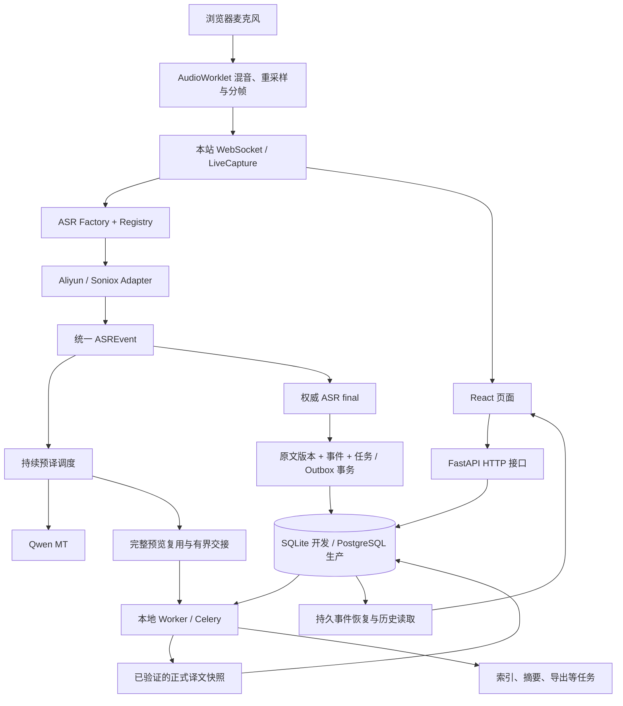

# ClassBridge 项目结构与模块职责

## P4 更新（2026-11-27）

ASR 共用异常位于 `providers/errors.py`；Qwen 纯协议位于 `providers/asr/aliyun_protocol.py`。`services/asr_config_resolver.py` 解释流启动时的有效配置；`transcript_state.py` 持有有界内存状态；`transcript_processor.py` 负责归一化时间、归属/活动流查询及现有正式保存边界。LiveCapture 保留协调器与翻译调度职责。浏览器 AudioCapture 增加正常 finish，紧急 stop 保留。

完整职责、依赖变化与未实施项见 [P4 报告](ASR_P4_VALIDATION.md)。没有新增 Registry、事件总线或数据库迁移。


本文说明当前项目“代码放在哪里、各模块负责什么、数据如何流动、修改功能时应从哪里进入”。内容根据实际源码整理，不是待实现的架构方案。

- 核对日期：2026-11-24。
- 源码基线：`703ce06dff44072efe0f317d2e6409d84f80607e`，分支 `feat/asr-profile-management`。
- Git 仓库根目录是 `同声传译chatbot/`；应用根目录是其中的 **`classbridge/`**。下文未特别注明的路径均相对于应用根目录。
- 本文只描述结构，不读取真实密钥、私人字幕、音频或数据库内容。服务是否正在运行、真实模型是否可用，应以实际检查结果为准。

## 1. 先理解各层的分工

| 层次 | 主要位置 | 负责什么 | 不负责什么 |
| --- | --- | --- | --- |
| 页面与交互 | `frontend/src/components/` | 登录、会话、字幕阅读、模型选择、资料和设置 | 不持有云模型长期密钥，不直接连接供应商 |
| 浏览器实时链路 | `frontend/src/lib/`、`frontend/public/audio/` | 麦克风、PCM 分帧、本站 WebSocket、字幕状态合并 | 不把临时识别自行定稿，不决定正式数据库证据 |
| HTTP 接口 | `backend/app/api/` | 鉴权、参数校验、归属检查、业务操作入口 | 不承担浏览器布局，不把所有耗时任务放在请求内执行 |
| 实时会话协调 | `backend/app/ws/live.py` | 录音状态、音频队列、ASR 结果、预译和收尾 | 不向前端暴露供应商原生协议 |
| 外部服务协议 | `backend/app/providers/` | 认证、请求格式、供应商事件转换、超时与错误分类 | 不决定用户页面和 RAG 权限 |
| 业务服务 | `backend/app/services/` | 原文版本、翻译协调、文档解析、检索、存储和导出 | 不替代数据库持久化和权限校验 |
| 持久化 | `backend/app/models/`、`migrations/` | 用户、字幕版本、任务、引用、模型配置及结构升级 | 不把临时预览当成正式原文 |
| 后台执行 | `backend/app/workers/tasks.py` | 翻译快照、索引、摘要、会后整理、导出、过期清理 | 不重新拥有麦克风，不无限重试付费请求 |
| 运维 | `deploy/` | 启动、代理、容器、备份、恢复 | 不代替外部域名、证书和真实账号授权 |

核心调用关系如下。图中预览翻译与音频转发是独立协调的工作，不能理解为音频必须等待翻译完成。



## 2. 总体目录

```text
同声传译chatbot/                         # Git 仓库根目录
├── .git/                              # 提交、分支等版本管理数据
├── .idea/                             # 当前工作区的 IDE 配置
├── .gitignore                         # 仓库级忽略规则
└── classbridge/                       # 应用根目录
    ├── backend/                       # Python 服务、迁移和测试
    │   ├── main.py                    # 可直接 Run/Debug 的后端入口
    │   ├── app/
    │   │   ├── main.py                # FastAPI 应用与生命周期
    │   │   ├── config.py              # 服务端环境配置
    │   │   ├── db.py                  # 数据库引擎与 Session
    │   │   ├── cli.py                 # 管理员初始化命令
    │   │   ├── api/                   # HTTP 路由
    │   │   ├── ws/                    # 实时 WebSocket
    │   │   ├── models/                # SQLAlchemy 表模型
    │   │   ├── schemas/               # 请求校验及输出整理辅助
    │   │   ├── providers/             # 云服务协议与 ASR 适配器
    │   │   ├── services/              # 业务服务
    │   │   ├── workers/               # 本地 / Celery 后台任务
    │   │   └── data/                  # 随源码版本管理的静态注册表
    │   ├── migrations/               # Alembic 结构迁移
    │   ├── tests/                    # 后端回归测试与 Mock 基准
    │   ├── alembic.ini                # Alembic 配置
    │   ├── pytest.ini                 # Pytest 配置
    │   ├── requirements.txt           # 直接依赖
    │   └── requirements.lock.txt      # 锁定的依赖版本
    ├── frontend/                      # React / TypeScript 前端
    │   ├── src/                       # 组件、状态逻辑与样式
    │   ├── public/audio/              # 浏览器直接加载的音频工作线程模块
    │   ├── tests/                     # 单元、交互与真实浏览器验收脚本
    │   ├── index.html                 # 浏览器入口 HTML
    │   ├── package.json               # npm 依赖和启动 / 检查命令
    │   ├── package-lock.json          # npm 依赖锁文件
    │   ├── vite.config.ts             # 开发服务、代理和构建配置
    │   ├── tsconfig*.json             # TypeScript 配置
    │   ├── tailwind.config.js         # Tailwind 主题映射
    │   ├── postcss.config.js          # CSS 构建处理
    │   └── LICENSE.minomeet           # 上游前端许可证
    ├── deploy/                        # 容器、Nginx、启动和备份脚本
    ├── docs/                          # 使用、设计、排错与验收文档
    ├── vendor/                        # 复用项目的许可证，非另一套应用
    ├── .run/                          # 可共享的 PyCharm 运行配置
    ├── .env.example                   # 服务端配置模板
    ├── .gitignore                     # 应用级忽略规则
    ├── .dockerignore                  # Docker 构建上下文排除规则
    ├── LICENSE                        # 项目许可证与归属说明
    └── README.md                      # 使用和部署总入口
```

上图省略了 Python 的 `__init__.py` 包标识文件，以及运行时生成的目录。**源码目录与运行数据不能混为一谈**：

| 目录 / 文件 | 性质及用途 |
| --- | --- |
| `.venv/` | 本机 Python 虚拟环境。运行解释器和依赖在这里，不是业务代码。 |
| `frontend/node_modules/` | npm 安装的依赖，不应手工修改来修复项目。 |
| `frontend/dist/` | `npm run build` 生成的前端产物；修改 `src/` 后重新构建。 |
| `backend/.pytest_cache/`、`__pycache__/` | 测试与 Python 运行缓存。 |
| `.local/` | 本地启动辅助文件、日志等；可能包含本地初始化凭据，不应公开。 |
| `data/`、`backend/data/` | 当前工作区存在的运行数据目录；实际使用位置由 `DATABASE_URL`、`DATA_DIR` 和启动工作目录决定，不能认为两个目录都在使用。 |
| `backups/` | 数据库与文件备份产物，不是可随意清理的构建缓存。 |
| `test-results/` | 自动验收生成的测试产物。 |
| `.env` | 实际服务端配置，可能含密钥。只在受控服务器 / 本机保存，不提交。 |
| `frontend/.env.local` | 本地 Vite 配置覆盖；不能用于保存供应商长期密钥。 |

特别注意：`backend/app/data/translation_languages.json` 是**源码中的静态语言注册表**，与上述运行数据目录完全不同。

## 3. 前端：页面、实时状态与样式

### 3.1 入口与页面组件

入口顺序为 `index.html → src/main.tsx → App.tsx → Shell / 页面组件`。前端沿用 React 18、TypeScript、Vite、Tailwind 及现有 Radix Dialog；没有另外引入一套聊天状态框架。

| 文件 | 具体职责 |
| --- | --- |
| [src/main.tsx](../frontend/src/main.tsx) | 挂载 React 根节点，加载上游基础样式与应用样式。 |
| [src/App.tsx](../frontend/src/App.tsx) | 应用总协调：登录初始化、页面切换、会话和偏好加载、录音中的导航保护、异步请求过期结果防护。 |
| [components/Shell.tsx](../frontend/src/components/Shell.tsx) | 桌面可折叠侧栏、手机抽屉、最近会话、顶部栏、主题和账户操作。这里的浏览器网络状态不等于 ASR 服务已经连接。 |
| [components/Home.tsx](../frontend/src/components/Home.tsx) | 工作台、新建入口、搜索、最近会话和现有统计；`NewSession` 也定义在此文件，负责会话类型、模式、目标语言、音频保留及 ASR 模型选择。 |
| [components/SessionView.tsx](../frontend/src/components/SessionView.tsx) | 实时 / 历史会话主体：双语字幕、时间线、阶段重点、问答、录音控制、诊断、导出、资料与引用跳转。持有单个 `useLive()`；响应式切换不能重新创建录音实例。 |
| [components/Settings.tsx](../frontend/src/components/Settings.tsx) | 阅读、主题、语言、术语、课程背景、拾音等用户偏好；保留草稿与显式保存。展示服务配置状态，并嵌入模型管理。 |
| [components/ASRModels.tsx](../frontend/src/components/ASRModels.tsx) | ASR 配置列表、新增、编辑、默认设置、启停、删除、配置检查。文件内的 `ASRSelector` 供新建和会话页复用。模型管理通过独立 API 保存，不等同于普通偏好草稿。 |
| [components/Library.tsx](../frontend/src/components/Library.tsx) | 上传资料、解析 / 索引状态、删除和来源预览。`DocumentPreview` 在此文件内，承担文档引用定位。 |
| [components/Chat.tsx](../frontend/src/components/Chat.tsx) | 问答范围选择、问题提交、回答和引用展示；调用后端检索，不在浏览器自行决定证据权限。 |
| [components/Login.tsx](../frontend/src/components/Login.tsx) | 私人账号登录，展示认证错误；无公开注册入口。 |
| `components/ui/` | 现有 `button.tsx`、`input.tsx`、`dialog.tsx`、`card.tsx`、`badge.tsx` 等通用组件。Dialog 提供焦点、Escape 关闭等交互基础，页面不必重复实现。 |

### 3.2 `src/lib/`：逻辑模块

| 文件 | 具体职责与边界 |
| --- | --- |
| [api.ts](../frontend/src/lib/api.ts) | 统一 HTTP 请求、Cookie 携带、错误处理及常用显示格式。前端访问本站相对路径，不把云服务认证暴露给浏览器。 |
| [types.ts](../frontend/src/lib/types.ts) | 会话、字幕、译文快照、引用、偏好及 ASR 配置等 TypeScript 类型。原文状态和译文状态分离；类型本身不承担运行时权限校验。 |
| [useLive.ts](../frontend/src/lib/useLive.ts) | 实时会话 Hook：协调连接、开始准备、音频发送、停止、事件合并、真实音量、健康状态和屏幕唤醒。恢复连接不自动重新打开麦克风。 |
| [liveConnection.ts](../frontend/src/lib/liveConnection.ts) | WebSocket 建立、存活检查、连接恢复和旧连接隔离。负责连接，不直接掌管浏览器麦克风。 |
| [audio.ts](../frontend/src/lib/audio.ts) | `AudioCapture`：申请麦克风、创建 AudioContext / AudioWorklet、应用用户处理偏好、传回帧及诊断、释放音频资源。 |
| [captureEvents.ts](../frontend/src/lib/captureEvents.ts) | 关联录音准备请求和 `stream_id`，过滤旧准备 / 就绪 / 停止控制事件，避免迟到事件影响新录音。 |
| [captureHealth.ts](../frontend/src/lib/captureHealth.ts) | 解释采集、待发送、上游转发和最近识别结果等健康指标；发送完成与模型返回文字是不同状态。 |
| [events.ts](../frontend/src/lib/events.ts) | 字幕事件合并核心。校验流、版本、事件身份、请求身份和目标语言；原文与译文分别更新；拒绝旧 partial 覆盖 final。兼容的完整预译通过 `fallback_preview` 在新请求输出期间保持可见。 |
| [timeline.ts](../frontend/src/lib/timeline.ts) | 将字幕片段与采集缺口组织为可排序、可定位的时间线，供会话页面展示。 |
| [asrProfiles.ts](../frontend/src/lib/asrProfiles.ts) | 获取模型列表及配置变更后的刷新通知，供多个模型选择器复用；不创建新的录音连接。 |
| [asrLanguages.ts](../frontend/src/lib/asrLanguages.ts) | `auto`、`ko_en`、`ko` 等识别输入模式的前端表达。它不是翻译目标语言配置。 |
| [translationLanguages.ts](../frontend/src/lib/translationLanguages.ts) | 读取共享的 14 种目标语言注册表，提供名称、方向等显示信息，避免前后端各维护一份语言列表。 |
| [classroomPreset.ts](../frontend/src/lib/classroomPreset.ts) | 课堂拾音相关设置的草稿辅助，不取代用户显式保存偏好的流程。 |
| [utils.ts](../frontend/src/lib/utils.ts) | 小型公共工具，例如组件 className 组合。 |

**字幕的职责划分**：`events.ts` 决定“哪个版本有资格显示”；`timeline.ts` 决定“按什么顺序组织”；`SessionView.tsx` 决定“怎么呈现和跟随滚动”。不要在 CSS 或视图组件里绕过版本保护。

### 3.3 `public/audio/`：实际音频处理

这几个文件由浏览器 AudioWorklet 直接加载，属于独立的运行环境，不是普通 React 组件。

| 文件 | 职责 |
| --- | --- |
| [capture-worklet.js](../frontend/public/audio/capture-worklet.js) | AudioWorklet 入口。读取声道、驱动重采样和分帧，传递帧与音量诊断；准备阶段可推迟实际帧发送，输出声道保持静音以免回放形成反馈。 |
| [pcm.js](../frontend/public/audio/pcm.js) | 连续重采样与 PCM 分帧。将设备采样率转换为 16 kHz 单声道 PCM16LE，正常每 320 个采样点形成一帧。 |
| [quality.js](../frontend/public/audio/quality.js) | 输入 RMS、峰值及可能削波的本地诊断。**不修改、筛除或门控 PCM 采样**，不是云端识别或降噪模型。 |

现有传输规格：`16,000 × 2 bytes × 1 channel = 32,000 bytes/s`；20 ms 一帧为 640 bytes。浏览器发送缓冲和服务端待转发队列是两个不同的位置，不能把其中一个的队列数当作另一个的状态。

### 3.4 样式、布局与构建配置

| 文件 / 目录 | 职责 |
| --- | --- |
| `src/upstream.css` | 保留 Minomeet 可用的基础样式。复用来源见 [FRONTEND_REUSE.md](FRONTEND_REUSE.md)。 |
| `src/style.css` | 按确定顺序引入当前样式体系，是样式汇总入口。 |
| `styles/tokens.css` | 明暗主题语义变量、颜色等设计基础。 |
| `styles/base.css` | 全局元素、排版、焦点和基础可访问性规则。 |
| `styles/layout.css` | 应用外壳、侧栏、抽屉、主内容容器、视口高度和滚动布局。 |
| `styles/components.css` | 跨页面的按钮、输入、卡片、Dialog 等公共样式。 |
| `styles/pages/session.css` | 字幕、辅助栏、问答、录音控制、移动端和横竖屏会话布局。 |
| `styles/pages/home.css` | 工作台、新建及最近会话布局。 |
| `styles/pages/library.css` | 资料卡片、上传和预览布局。 |
| `styles/pages/settings.css` | 偏好表单、模型管理等设置页布局。 |
| `styles/pages/login.css` | 登录页布局。 |
| `vite.config.ts` | 开发端口、允许访问的主机、`/api` 与 `/ws` 代理、共享语言 JSON 的访问范围。手动 `npm run dev` 当前默认端口为 **80**；启动脚本显式指定的 **5173** 是另一种启动方式。 |
| `tsconfig.json`、`tsconfig.node.json` | 应用与构建配置的 TypeScript 检查范围。 |
| `tailwind.config.js`、`postcss.config.js` | 现有主题映射和 CSS 编译管线。 |

改变布局优先修改所属样式文件；改变窗口宽度、页签、主题或抽屉时，应保留 `SessionView`、`useLive` 和音频资源的原有生命周期。

## 4. 后端：入口、接口和实时会话

### 4.1 启动与基础设施

| 文件 | 职责 |
| --- | --- |
| [backend/main.py](../backend/main.py) | 面向命令行 / PyCharm 的 `if __name__ == "__main__"` 启动入口。固定工作目录为 `backend/`，启动 Uvicorn；默认 `0.0.0.0:8000`，支持 `--host`、`--port`。 |
| [app/main.py](../backend/app/main.py) | 创建 FastAPI、注册路由、处理启动 / 关闭、恢复遗留录音状态、启动本地任务循环、服务端来源和频率限制、安全响应头及统一异常。文档 `/api/docs`，健康检查 `/api/health`。 |
| [app/config.py](../backend/app/config.py) | Pydantic Settings，读取应用根目录 `classbridge/.env` 及环境变量。包含数据库、任务模式、模型、超时、预译预算和存储配置。 |
| [app/db.py](../backend/app/db.py) | SQLAlchemy Engine、SessionLocal 和请求级数据库会话；SQLite 设置外键、WAL、锁等待；PostgreSQL 支持 pgvector。 |
| [app/cli.py](../backend/app/cli.py) | 服务器端创建管理员或显式重设密码。不存在面向公众的注册流程。 |

两个 `main.py` 分工不同：外层是“如何启动进程”，内层是“进程里运行哪个 FastAPI 应用”。开发环境的 `create_all()` 不能替代已有数据库的 Alembic 列升级。

### 4.2 `app/api/`：HTTP 入口

| 文件 | 主要接口 / 功能 | 关键职责 |
| --- | --- | --- |
| [auth.py](../backend/app/api/auth.py) | `/api/auth/login`、`/me`、`/logout` | 密码验证、登录 Cookie、登录会话及当前用户；提供其他 API 复用的身份校验。 |
| [sessions.py](../backend/app/api/sessions.py) | `/api/sessions` 及详情、模型切换、清空、删除、摘要、会后整理、版本、说话人映射、导出 | 会话归属、生命周期限制、历史聚合、正式版本读取；活跃录音期间阻止破坏性操作和模型切换。 |
| [settings.py](../backend/app/api/settings.py) | `/api/settings` | 读取 / 保存偏好、报告服务配置状态。实时 ASR 可用性按模型检查，MT 等阿里云能力仍独立检查。 |
| [asr.py](../backend/app/api/asr.py) | `/api/asr/providers`、`/profiles` 及配置 CRUD、`/validate` | 可信供应商能力、模型配置管理、所有权和在用检查。默认验证不调用模型；明确确认的真实连接检查可能计费。 |
| [knowledge.py](../backend/app/api/knowledge.py) | `/api/documents`、来源文件、`/api/chat`、`/api/storage/signed` | 上传、资料访问、问答及引用入口；短期签名对象访问有独立能力校验，不是公开文件目录。 |

前端按钮是否可点击只是交互提示；真正的用户归属、模型可用性、字段白名单和录音状态限制必须在服务端执行。

### 4.3 `app/ws/live.py`：录音实时中枢

`websocket_session()` 是 `/ws/sessions/{session_id}` 的入口，执行认证、Origin 与会话检查，并支持按 `after_seq` 恢复持久事件。`LiveCapture` 管理一次录音流的资源和状态：

1. **准备**：检查选定 ASR 配置、启用状态、凭据及 Adapter，创建新的 `stream_id` 和固定配置快照。
2. **采集接收**：接收浏览器 PCM，校验格式及会话状态，进入有界音频队列。容量约两秒，不通过无界缓存掩盖网络阻塞。
3. **上游发送 / 接收**：将音频交给 Provider，同时消费标准 ASR 事件；保持音频发送与字幕、数据库等工作的隔离。
4. **字幕处理**：partial 更新临时原文；final 通过 `events.save_final()` 保存权威版本，预译调度独立运行。
5. **诊断与存储**：发送 `capture.health`、错误和缺口；选择保留音频时处理 WAV 暂存与文件存储。
6. **停止收尾**：排空已接受的音频、有界等待上游定稿、处理未确认原文、关闭子任务和连接。首次真实失败原因不能被随后关闭错误覆盖。

这里协调原有传统预译和可选增量预译，但不直接承担外部供应商协议定义，也不把翻译结果写回 ASR 原文。

## 5. Provider：供应商适配与模型配置

### 5.1 通用云服务与传输辅助

| 文件 | 职责 |
| --- | --- |
| [providers/aliyun.py](../backend/app/providers/aliyun.py) | 现有阿里云协议实现：流式 ASR、Qwen MT、文本生成、Embedding、Rerank 和文件转写；统一 `ProviderError` 及错误分类。ASR 保留 `run-task / task-started / finish-task` 等原协议。 |
| [providers/transport.py](../backend/app/providers/transport.py) | 缓存 TLS 上下文，避免证书初始化阻塞实时事件循环；提供有取消收尾保证的阻塞操作辅助，以及 PCM 帧和队列容量常量。线程里的数据库操作应在线程内创建和关闭 Session。 |

### 5.2 `providers/asr/`：只抽象实时 ASR

| 文件 | 职责 |
| --- | --- |
| [base.py](../backend/app/providers/asr/base.py) | 定义 `ASRProvider` Protocol 和 `ASREvent`，统一句子身份、文本、时间、是否 final 等消费者需要的字段。 |
| [registry.py](../backend/app/providers/asr/registry.py) | 可信供应商注册表：Adapter、默认模型标识、凭据引用、能力及专属参数白名单。前端不能通过自行填写字段宣称供应商具备不存在的能力。 |
| [factory.py](../backend/app/providers/asr/factory.py) | 根据配置 / 快照查注册表并创建 Adapter。同一供应商增加模型配置不需要新增 Factory 条件分支；失败明确报错，不偷偷切换模型或模拟模式。 |
| [aliyun.py](../backend/app/providers/asr/aliyun.py) | ASR 专用包装器，复用外层 `providers/aliyun.py` 的识别协议和现有参数行为。 |
| [soniox.py](../backend/app/providers/asr/soniox.py) | Soniox STT v6 实时协议：服务端认证、配置握手、PCM 发送、确认 / 临时 token 整理、句子身份和供应商时间映射、结束和异常清理。 |
| [evaluation.py](../backend/app/providers/asr/evaluation.py) | 同一规范 WAV 的评测入口及离线 WER / CER、术语保留率计算；没有人工参考文本不报告准确率，真实模型执行须显式允许计费。不是日常 Worker。 |

截至本文基线：**Aliyun、Soniox 已有 Adapter**；ElevenLabs、Deepgram 只有注册位置并标记“尚未接入”；Daglo、NAVER、RTZR 尚无可运行 Adapter。代码和 Mock 协议验证不代表对应账号权限或真实课堂效果已经通过。

### 5.3 模型配置与参数服务

- [services/asr_profiles.py](../backend/app/services/asr_profiles.py)：配置 CRUD 所需的规范化、所有权、默认配置、旧环境配置引导、可用性检查、在用限制及录音快照。数据库保存 `credential_ref`，不保存返回给前端的密钥正文。
- [services/asr_options.py](../backend/app/services/asr_options.py)：输入语言提示、热词和课程背景整理，包括韩语 NFC、重复项及无效项处理。识别输入提示与字幕翻译目标是两套概念。
- `ASRProfile` 是可编辑配置；`Session` 保存选择；`RecognitionStream` 保存这次录音真正使用的供应商、模型及配置快照。因此删除配置不能让旧录音失去模型信息。
- 换用 Soniox 只改变实时 ASR；Qwen MT、文件转写、向量、重排和摘要等仍可能需要阿里云凭据。

## 6. `services/`：业务逻辑集中层

| 文件 | 详细职责 |
| --- | --- |
| [events.py](../backend/app/services/events.py) | 正式原文、译文和事件的核心事务。`emit()` 分配持久事件序号；`enqueue()` 建任务及 Outbox；`save_final()` 保存原文版本、final 事件及索引 / 翻译任务；`save_translation()` 校验当前正式源版本后保存译文。`save_interrupted()` 只保留恢复用未确认事件，不创建正式 RAG 证据。 |
| [stable_prefix.py](../backend/app/services/stable_prefix.py) | 从连续识别假设提取可撤回的完整词前缀，应用稳定等待、短句和有界回退规则。稳定前缀只是预译候选，不是 ASR 权威定稿。 |
| [incremental_translation.py](../backend/app/services/incremental_translation.py) | `IncrementalTranslator`、请求预算、有效输入去重、候选调度、完整输出检测、预览缓存及严格复用校验；包含目标语言、模型 / 术语规格摘要和 TTL 等约束。 |
| [translation_dispatch.py](../backend/app/services/translation_dispatch.py) | 在途预译与正式任务的持久化交接、截止时间和提交后唤醒。本地唤醒只是加速，Outbox 才是可靠依据；不把内存 `asyncio.Task` 当作跨 Celery 进程共享对象。 |
| [translation_timing.py](../backend/app/services/translation_timing.py) | 翻译排队、首字等阶段计时，区分墙上时间和过程耗时。 |
| [translation_languages.py](../backend/app/services/translation_languages.py) | 读取并校验 14 种目标语言，映射到模型参数与语言方向；避免缓存、术语或正式译文混用目标语言。 |
| [timing.py](../backend/app/services/timing.py) | 录音时长与各识别流的时间关系，避免将暂停 / 断线间隔全部算为实际采集时长。 |
| [documents.py](../backend/app/services/documents.py) | PDF、PPTX、DOCX 内容校验和解析，构造 LangChain Document 文本块与来源位置；Office 解压限制、扫描件 / 空文档明确报错或警告。PDF 使用页码，PPTX 使用幻灯片编号，DOCX 使用段落 / 表格及字符位置，不伪造固定页码。 |
| [knowledge.py](../backend/app/services/knowledge.py) | 正式字幕及文档索引、阶段总结、关键词与向量混合召回、去重、重排、回答及引用校验。召回与发给模型前检查权限和来源版本；尚未向量化的正式原文可参与当前会话检索。 |
| [storage.py](../backend/app/services/storage.py) | `Storage` 接口及本地、S3、OSS 实现，统一 `put/read/delete/signed_url`；保护对象路径，签名访问短期有效。默认本地对象位于 `DATA_DIR/objects/`，音频暂存另行管理。 |
| [exporting.py](../backend/app/services/exporting.py) | 将会话导出文本排版为 PDF，处理 Unicode 字体、CJK 和 RTL。Markdown / TXT 内容准备与导出路由在 `api/sessions.py`，后台导出执行在 Worker。 |
| [retired_tasks.py](../backend/app/services/retired_tasks.py) | 识别和拦截已经下线的旧推测矫正任务，防止历史队列重新执行。它不是当前启用的自动推测改写功能。 |

`schemas/sessions.py` 承担会话相关请求结构校验；`schemas/stages.py` 提供阶段文本清理辅助，例如避免把空值或字面量 `None` 当成有效标题。当前没有把所有 API Schema 都拆到 `schemas/`，部分请求模型仍定义在所属路由文件内。

## 7. 数据库：每类记录存什么

所有 SQLAlchemy 模型目前集中在 [app/models/__init__.py](../backend/app/models/__init__.py)，不是每张表一个文件。

| 模型 / 表 | 保存内容与作用 |
| --- | --- |
| `User` / `users` | 私人用户、密码散列及用户偏好。 |
| `LoginSession` / `login_sessions` | 登录令牌摘要和有效期，用于 Cookie 认证与退出。 |
| `Session` / `sessions` | 课堂 / 会议 / 访谈、归属、模式、锁定的翻译目标、录音状态、当前流、时长与模型选择。 |
| `RecognitionStream` / `recognition_streams` | 每次上游识别任务的身份、偏移、状态和 ASR 配置快照。一个会话可有多次录音流。 |
| `ASRProfile` / `asr_profiles` | 用户的供应商、模型 ID、名称、语言提示、启用 / 默认状态、凭据引用、合法专属参数及时间。 |
| `SegmentRevision` / `segment_revisions` | 权威原文的具体版本、文本、时间范围、流身份、状态、来源与延迟。新修订保留旧版本的可追溯性。 |
| `Translation` / `translations` | 绑定原文版本和目标语言的正式译文及翻译版本；临时预览不会冒充此记录。 |
| `Event` / `events` | 可恢复的事件历史和 `event_seq`，供断线重放与恢复未确认内容。并非所有高频瞬态 token 都逐条入库。 |
| `ProcessingTask` / `processing_tasks` | 后台任务种类、载荷、状态、幂等键、尝试 / 错误及外部任务相关信息。 |
| `Outbox` / `outbox` | 与业务事务一起写入的投递记录，避免“字幕已保存但任务未可靠提交”。 |
| `Stage` / `stages` | 阶段提取结果及所绑定的来源版本。 |
| `Fact` / `facts` | 从正式内容提取的知识点、术语等结构化事实及证据。 |
| `ActionItem` / `action_items` | 明确行动项及负责人、时间等字段；无明确证据不能猜测填入。 |
| `Document` / `documents` | 上传文件的归属、版本、存储位置、解析 / 索引状态。 |
| `Chunk` / `chunks` | 文档或正式原文的检索块、向量及页码 / 位置等来源元数据。 |
| `Chat` / `chats` | 问题、回答及会话 / 用户关联。 |
| `Citation` / `citations` | 服务端验证的回答证据、来源版本、标签与文档位置。 |
| `AudioAsset` / `audio_assets` | 保留音频的文件引用、真实偏移、时长、缺口及保留 / 存储状态。 |

### 7.1 容易混淆的身份与版本

| 字段 | 含义 |
| --- | --- |
| `session_id` | 用户打开的课堂 / 会议会话。 |
| `stream_id` | 一次新的上游识别任务，重连或重新录音时用于隔离旧结果。 |
| `sentence_id` | 句子身份；实际业务身份结合识别流，不能把不同流中的同号句子视为同一句。 |
| `source_revision` | 当前原文版本关联，译文和引用必须匹配。 |
| `text_revision` | 现有实时状态中区分文本有效变化的标识，不应与数据库原文版本混为一谈；不是要求所有表都有此列。 |
| `translation_revision` | 译文版本，不能用于改写原文版本。 |
| `preview_request_id` | 同一句预译请求的身份，拒绝旧请求迟到输出。 |
| `preview_complete` | 模型这一份预览已完整结束，**不代表正式译文已经落库**。 |
| `preview_source_text` | 预译实际采用的源文，用于检查与当前原文是否兼容。 |
| `event_id` / `event_seq` | 事件身份与持久化恢复顺序，不是模型 token 编号。 |

### 7.2 Alembic 迁移

| 文件 | 升级内容 |
| --- | --- |
| `migrations/env.py` | 迁移运行环境与数据库连接。 |
| `migrations/schema_v1.py` | 冻结的初始结构，防止以后修改 ORM 时反向改变初始迁移含义。 |
| `versions/0001_initial.py` | 初始业务表结构。 |
| `versions/0002_citation_locations.py` | 引用标签、字符位置及来源位置说明。 |
| `versions/0003_translation_language.py` | 会话 / 译文的目标语言持久化。 |
| `versions/0004_asr_profiles.py` | 模型配置、会话选择及识别流快照；兼容旧默认配置。旧历史推定配置有来源标记，不能当成当时实测的精确快照。 |

已有数据库升级使用 `alembic upgrade head`。先停止相关写入进程并备份，再按部署文档升级；不能删除数据库重新创建来代替兼容迁移。

## 8. Worker 与 Outbox 为什么同时存在

[workers/tasks.py](../backend/app/workers/tasks.py) 同时提供本地执行循环和 Celery 入口，两种运行模式共用任务语义。

| 组成 | 职责 |
| --- | --- |
| `execute_task()` | 按任务 ID 加载数据库状态、校验有效性、执行对应业务、更新成功 / 等待 / 失败状态及有限重试。 |
| `translate()` | 先核验完整预译或等待有界交接；可安全复用则持久化正式快照，否则在规则允许时做必要补偿 MT。缺失完整性证据的 token 不生成假 final。 |
| `reprocess()` | 使用保留音频做会后文件转写，保存为新版本并重建相关派生内容；不静默覆盖旧引用。 |
| 知识任务 | 调用 `services/knowledge.py` 进行文档处理、原文索引和阶段总结。 |
| 导出任务 | 生成报告，写入存储，由授权接口返回结果。 |
| `dispatch_outbox()` | 将事务内记录的待投递任务交给执行器；重复投递由任务幂等保护处理。 |
| `expire_audio()` / `recover_abandoned()` | 清理到期音频、处理遗留任务状态；外部付费请求结果不确定时不能简单无限重发。 |
| `local_worker_loop()` | 开发模式在 API 进程中运行的固定任务循环。无需 Redis / Celery 进程即可完成本地模拟链路。 |
| `celery_app`、`process_task()`、Beat | 生产模式使用 Redis 传递任务，独立 Worker 执行，Beat 定时投递 / 清理。Redis 不是字幕、引用和正式结果的唯一持久化来源。 |

Outbox 解决的是**提交可靠性**，Worker 解决的是**何时和在哪里执行**。保留 Outbox 并不意味着每个 ASR final 都要再调用一次 MT；正式任务可以直接核验并保存已经完成的兼容预译。

## 9. 五条常见业务链路

### 9.1 录音到原文字幕

`SessionView → useLive → AudioCapture → capture-worklet → PCM → 本站 WebSocket → LiveCapture → ASR Factory / Adapter → 标准 ASREvent`。

partial 供前端即时阅读；供应商确认 final 后才经 `save_final()` 保存正式原文。未确认内容可以作为 `transcript.interrupted` 恢复展示，但不会因此进入正式 RAG 索引。翻译失败不影响已确认原文保存。

### 9.2 原文到翻译

`ASR partial → 传统 / 增量预译调度 → Qwen MT 流式输出 → translation.partial → 前端快照合并`。

首次译文允许流式显示。已经有完整且兼容的预览时，新请求中间 token 更新请求状态，但主显示保持旧完整预览；新请求完整后再切换。源文不兼容改写时，旧预览必须失效。ASR final 经事务建立正式任务，Worker 严格核验复用 / 交接或执行必要兜底，最终保存 `translation.final`。

### 9.3 资料上传到证据问答

`Library → /api/documents → 私有 Storage + 文档记录 / 任务 → Worker → documents.parse_document → 文本块 / 向量`。

`Chat → /api/chat → 带权限的混合检索 → 重排与二次来源检查 → 回答模型 → 服务端验证引用 → Citation → 前端定位字幕或文件位置`。

扫描件不会被静默视为“解析成功但没内容”。DOCX 没有固定页码时使用段落 / 表格位置；模型自行生成的引用 ID 不能直接成为可信引用。

### 9.4 ASR 模型管理与切换

`Settings / ASRModels → /api/asr/profiles → asr_profiles 服务 → ASRProfile`；新建会话或停止后的模型选择更新 Session。开始录音时再次验证并生成 `RecognitionStream` 快照，Factory 创建对应 Adapter。录音与收尾期间禁止更换当前模型；历史展示读取流快照，而不是依赖仍然存在的配置名称。

### 9.5 停止、刷新与恢复

停止先释放浏览器麦克风，服务器对已接收音频有界排空并等待最终结果。正式记录保留，无法恢复的音频显示缺口。刷新读取会话历史，WebSocket 按持久事件序号恢复；恢复页面不等于重新采音，用户仍需主动开始。

## 10. 部署、配置和持久化文件

### 10.1 `deploy/` 文件说明

| 文件 | 用途 |
| --- | --- |
| [compose.yaml](../deploy/compose.yaml) | 组合 PostgreSQL、Redis、迁移、API、Worker、Beat 和前端 Nginx，声明健康检查、启动依赖和持久化卷。 |
| [Dockerfile.backend](../deploy/Dockerfile.backend) | 后端依赖及运行镜像，供 API、迁移和后台任务复用。 |
| [Dockerfile.frontend](../deploy/Dockerfile.frontend) | 构建 Vite 静态资源，交给 Nginx 提供页面。构建上下文也需包含共享语言 JSON。 |
| [nginx.conf](../deploy/nginx.conf) | 静态前端、HTTP API 及 WebSocket 代理；保留 Upgrade、超时和关闭代理缓冲等配置。签名文件访问避免写入普通访问日志。 |
| [init-db.sql](../deploy/init-db.sql) | PostgreSQL / pgvector 初始化辅助。 |
| [start-local.ps1](../deploy/start-local.ps1)、[start-local.sh](../deploy/start-local.sh) | Windows / Linux 本地开发启动，按参数执行安装和管理员初始化；前端脚本入口端口为 5173。 |
| [stop-local.ps1](../deploy/stop-local.ps1) | 停止本地启动脚本管理的进程。 |
| [backup.sh](../deploy/backup.sh) | Compose 部署备份：暂停应用写入，导出 PostgreSQL 并打包 `/data` 文件，然后恢复服务。密钥配置另行安全备份。 |
| [restore.sh](../deploy/restore.sh) | 恢复数据库和文件并执行迁移；要求显式 `--replace-database`，属于会替换现有内容的运维操作，不是普通启动步骤。 |
| [smoke_local.py](../deploy/smoke_local.py) | 本地端到端冒烟验证脚本；使用前先确认测试环境，不能把它当成只读健康检查。 |
| [verify_models.py](../deploy/verify_models.py) | 真实云模型短请求核验工具，可能计费；不属于默认 Mock 回归，本次文档整理未执行。 |

### 10.2 Compose 各服务

| 服务 | 职责 |
| --- | --- |
| `frontend` | Nginx 提供构建后的网页，统一代理 API / WebSocket。 |
| `api` | FastAPI 用户请求与实时录音连接。 |
| `migrate` | 运行 Alembic 升级，先于依赖新结构的服务就绪。 |
| `worker` | 独立 Celery 后台任务执行。 |
| `beat` | 周期调度 Outbox、过期清理和恢复检查。 |
| `postgres` | 正式业务数据及 pgvector，使用持久化卷。 |
| `redis` | Celery 消息传输及运行相关状态，使用持久化配置。 |

开发环境使用 SQLite + 本地 Worker；生产校验要求 PostgreSQL + Celery、强密钥、安全 Cookie 和明确 HTTPS Origin。外层宝塔 / 1Panel / HTTPS 代理需正确转发 WebSocket。VPN 连通不自动满足浏览器麦克风的安全上下文要求，见 [VPN_HTTPS.md](VPN_HTTPS.md)。

### 10.3 配置放在哪里

- 服务端实际配置：`classbridge/.env`；参考模板：[.env.example](../.env.example)。修改密钥和模型环境变量后需要重启读取它们的 API / Worker。
- 旧 ASR 环境变量继续用于兼容默认配置；可编辑的模型配置存在数据库。只改旧变量不应被理解为会重写所有现有 Profile。
- `DASHSCOPE_API_KEY`、`SONIOX_API_KEY` 等仅由后端读取。前端模型管理填写合法参数和凭据引用，不填写或返回真实 Key。
- 对象文件、数据库和配置备份职责不同。只备份 Git 仓库不能恢复用户课堂记录；只备份数据库也不能恢复原音频 / 文档文件。

## 11. 测试目录与验证边界

### 11.1 后端 `backend/tests/`

| 测试组 | 主要文件 | 保护内容 |
| --- | --- | --- |
| 传输与实时生命周期 | `test_transport.py`、`test_live_ordering.py`、`test_classroom_audio.py` | 有界 PCM、发送 / 接收超时、停止、事件顺序、缺口与资源清理。 |
| Provider 与模型管理 | `test_providers.py`、`test_soniox.py`、`test_asr_profiles.py`、`test_asr_evaluation.py` | 协议 Mock、错误处理、CRUD、隔离、固定快照及评测计算。 |
| 连续翻译 | `test_incremental_translation.py`、`test_stable_prefix.py`、`test_continuous_translation.py` | 短句、前缀、去重、预算、预览复用和在途交接。 |
| 翻译完整性与调度 | `test_translation_scheduling.py`、`test_translation_stream_completion.py`、`test_dual_pipeline.py` | ASR / MT 独立、完整输出、正式快照、失败与迟到保护。 |
| 业务与证据 | `test_core.py`、`test_knowledge.py`、`test_exporting.py` | 登录 / 会话、事务、检索权限、引用、解析和报告。 |
| 语言与迁移 | `test_multilingual_translation.py`、`test_multilingual_migration.py`、`test_migrations.py` | 14 种目标语言、版本隔离、SQLite 等结构升级行为。 |
| 启动与历史兼容 | `test_launch.py`、`test_project_review.py`、`test_retired_correction.py` | 启动入口、集成约束、废弃任务不会重新改写原文。 |
| 基准与渲染工具 | `benchmark_audio_transport.py`、`benchmark_translation.py`、`benchmark_translation_scheduler.py`、`benchmark_incremental_replay.py`、`render_multilingual_export.py` | 可重复 Mock 性能回放和导出渲染辅助，不等同于真实课堂准确率验证。 |

### 11.2 前端 `frontend/tests/`

| 测试组 | 主要文件 | 保护内容 |
| --- | --- | --- |
| 字幕与译文状态 | `events.test.ts`、`incrementalTranslation.test.ts`、`dualPipeline.test.ts`、`timeline.test.ts` | 原文 / 译文隔离、完整预览保留、版本拒绝、历史恢复与排序。 |
| 采音与连接 | `audio.test.ts`、`audioReady.test.ts`、`liveConnection.test.ts`、`captureEvents.test.ts`、`captureHealth.test.ts`、`classroomAudio.test.ts` | 重采样、准备握手、资源释放、连接变化及真实诊断含义。 |
| 页面交互 | `uiInteraction.test.ts`、`sessionView.test.ts`、`settings.test.ts` | Dialog、导航、录音保护、设置保存和模型管理等交互。 |
| 多语言与兼容 | `multilingual.test.ts`、`retiredCorrection.test.ts` | 语言注册表 / RTL 及废弃功能兼容。 |
| 性能与真实浏览器 | `benchmark_subtitles.ts`、`browser/responsive.mjs`、`browser/asr-models.mjs` | 字幕回放、Chromium 多视口测量与模型管理视觉检查。 |

`npm test` 执行 `tests/*.test.ts`；`tests/browser/` 的脚本是独立浏览器验收，不会因此自动全部执行。happy-dom 的组件交互结果不能当成真实 CSS 布局测量，Chromium 模拟尺寸也不能当成实体 Safari 验收。

## 12. 文档导航与许可证

| 文档 | 阅读场景 |
| --- | --- |
| [README.md](../README.md) | 首次启动、模拟体验、配置与部署总入口。 |
| [PYCHARM_DEBUG.md](PYCHARM_DEBUG.md) | 现有虚拟环境、Run / Debug、端口与启动排错。 |
| [API.md](API.md) | HTTP / WebSocket 接口契约；运行时完整 HTTP Schema 另见 `/api/docs`。 |
| [ASR_MODELS.md](ASR_MODELS.md) | 多 ASR 管理、接口、Soniox 配置、迁移与实测限制。 |
| [MODEL_COMPATIBILITY.md](MODEL_COMPATIBILITY.md) | 官方文档核验、模型协议和“文档支持 / API 测试 / 课堂效果”区别。 |
| [IMPLEMENTATION_CONTRACT.md](IMPLEMENTATION_CONTRACT.md) | 实现约束与一致性约定。 |
| [ASR_DUAL_PIPELINE.md](ASR_DUAL_PIPELINE.md)、[ASR_INCREMENTAL_TRANSLATION.md](ASR_INCREMENTAL_TRANSLATION.md) | 原文 / 翻译独立与增量翻译机制。 |
| [CONTINUOUS_TRANSLATION.md](CONTINUOUS_TRANSLATION.md)、[TRANSLATION_SUBTITLE_STABILITY.md](TRANSLATION_SUBTITLE_STABILITY.md) | 持续预译、final 交接、重复请求和字幕稳定性修改记录。 |
| [MULTILINGUAL_TRANSLATION.md](MULTILINGUAL_TRANSLATION.md) | 14 种目标语言、数据库兼容和导出。 |
| [AUDIO_PIPELINE_STABILITY.md](AUDIO_PIPELINE_STABILITY.md)、[ASR_RELIABILITY_2026_11.md](ASR_RELIABILITY_2026_11.md) | 音频队列、异步隔离、超时与可靠性测试。 |
| [CLASSROOM_AUDIO_PHASES.md](CLASSROOM_AUDIO_PHASES.md)、[ASR_LOGIC_REVIEW.md](ASR_LOGIC_REVIEW.md) | 课堂拾音及既往识别逻辑检查。 |
| [REALTIME_TROUBLESHOOTING.md](REALTIME_TROUBLESHOOTING.md) | 音频积压、识别中断、缺口及诊断解释。 |
| [FRONTEND_REUSE.md](FRONTEND_REUSE.md)、[FRONTEND_PHASE1_REDESIGN.md](FRONTEND_PHASE1_REDESIGN.md) | Minomeet / 现有视觉体系的实际复用与重写边界。 |
| [RESPONSIVE_LAYOUT_AUDIT.md](RESPONSIVE_LAYOUT_AUDIT.md)、`docs/screenshots/` | 实际多视口验收、截图与测量产物。 |
| [DEPLOYMENT.md](DEPLOYMENT.md)、[VPN_HTTPS.md](VPN_HTTPS.md) | 服务器、容器、备份、HTTPS 和 VPN 访问。 |
| [FEATURE_STATUS.md](FEATURE_STATUS.md)、[TEST_RESULTS.md](TEST_RESULTS.md)、[PROJECT_CHECK.md](PROJECT_CHECK.md) | 功能状态和阶段验收记录；需要结合记录日期，不能把早期限制或计数当成最新运行事实。 |

项目采用 MIT，具体见 [LICENSE](../LICENSE)。上游归属保留在 `vendor/MINOMEET_LICENSE`、`vendor/SHADCN_ADMIN_LICENSE` 和 `frontend/LICENSE.minomeet`。Minomeet 的原业务后端没有同时运行；其原录音和 API 状态已由本项目链路替代。`vendor/` 当前是许可证存放位置，不是可以独立启动的上游源码目录。

## 13. 日常开发应从哪里改

| 要调整的内容 | 首先查看 | 应避免影响 |
| --- | --- | --- |
| 字幕面积、字号层级、移动布局 | `SessionView.tsx`、`styles/pages/session.css`、`layout.css` | 不因断点变化重建 `useLive`；不缩小用户设置的译文字号来掩盖布局问题。 |
| 译文闪空、旧 token 覆盖 | `lib/events.ts`、`types.ts`、对应字幕回归测试 | 不删除版本 / 请求身份校验，不改变 ASR 原文。 |
| 预译重复请求或 final 交接 | `incremental_translation.py`、`live.py`、`translation_dispatch.py`、`workers/tasks.py` | 不取消正式快照 / Outbox，不默认增加付费重试。 |
| 韩英输入提示、术语 | `asr_options.py`、`asr_profiles.py`、当前 Adapter | 不把翻译目标传作 ASR 输入，不凭猜测增加供应商参数。 |
| 新供应商 | `providers/asr/base.py`、`registry.py`、对应 Adapter、协议测试 | 不让 `live.py` 依赖供应商原生事件，不在前端保管 Key。 |
| 队列溢出或停止不收尾 | `useLive.ts`、`audio.ts`、`live.py`、`transport.py`、Provider 测试 | 不无界扩大缓冲，不静默跳帧，不把未定稿原文保存为 final。 |
| 资料解析和引用 | `documents.py`、`knowledge.py`、`api/knowledge.py` | 不伪造页码，不绕过权限和来源版本检查。 |
| 表结构 | `models/__init__.py`、新 Alembic 迁移及迁移测试 | 不直接改用户数据库，不修改冻结初始迁移来假装完成升级。 |
| 上线与端口 / 域名 | `.env.example`、`deploy/`、部署文档 | 不泄露实际 `.env`，不关闭生产安全要求来通过启动。 |

## 14. 常用入口与检查命令

以下是命令说明，并非本文编写时重新执行过的完整验收结果。

在 `classbridge/` 下，使用当前已有 Windows 虚拟环境启动后端：

```powershell
.\.venv\Scripts\python.exe .\backend\main.py --host 127.0.0.1 --port 8000
```

前端在另一个终端执行：

```powershell
cd frontend
npm run dev
```

手动开发前端当前访问 `http://localhost/`，API 文档为 `http://127.0.0.1:8000/api/docs`。如果使用 `deploy/start-local.ps1`，则按脚本的 5173 入口访问。地址存在于配置不代表服务已经启动。

后端测试在 `classbridge/backend/` 下执行：

```powershell
..\.venv\Scripts\python.exe -m pytest -q
```

前端检查在 `classbridge/frontend/` 下执行：

```powershell
npm test
npm run typecheck
npm run build
```

`.run/ClassBridge_Migrate.run.xml` 和 `.run/ClassBridge_Tests.run.xml` 是迁移 / 测试的 PyCharm 配置；日常后端断点可直接使用 `backend/main.py`。涉及迁移、恢复和真实云模型验证时，应先阅读对应文档，不能把这些命令当作普通只读检查。
