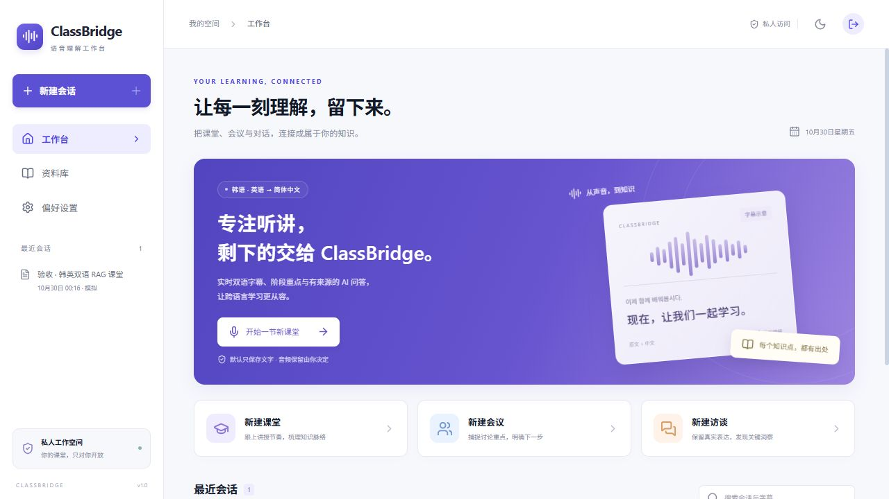
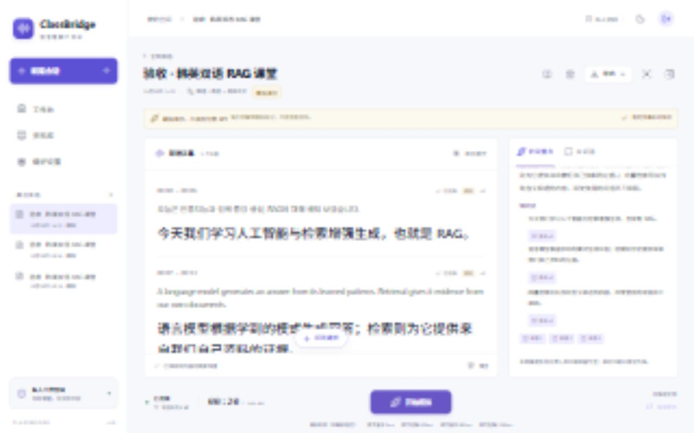
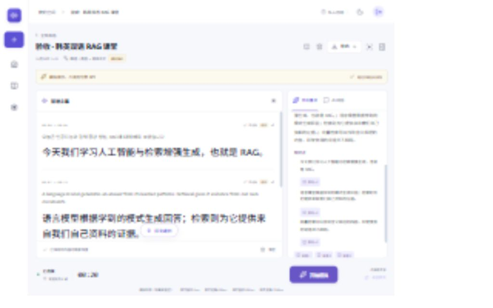
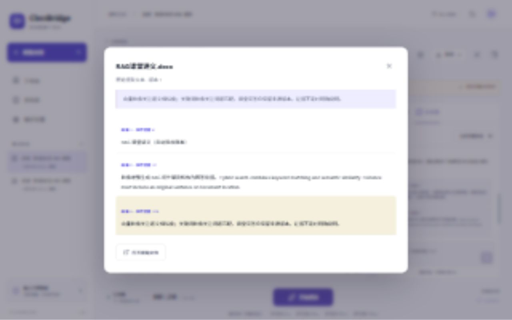
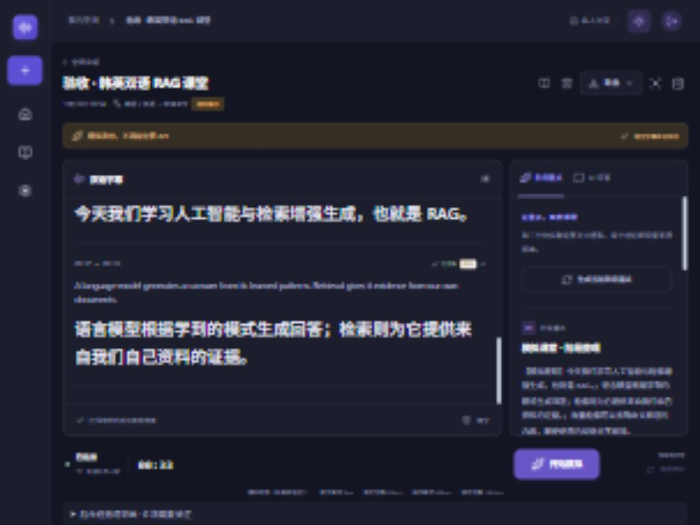
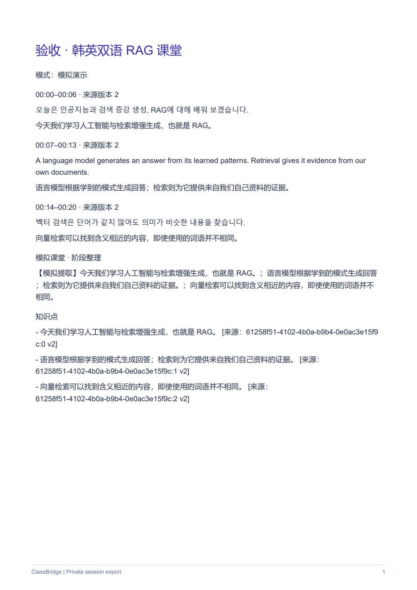

# 实际测试与验收记录

## P4 续作回归（2026-11-28）

| 检查 | 结果 |
| --- | --- |
| INCREMENTAL_TRANSLATION_ENABLED=false | 554 passed, 1 skipped，132.05s |
| INCREMENTAL_TRANSLATION_ENABLED=true | 554 passed, 1 skipped，132.36s |
| npm test | 140 passed，0 failed/skip |
| npm run typecheck | 通过 |
| npm run build | 通过 |
| git diff --check | 通过 |

本轮新增 12 个后端用例（时间状态 1、外部数据库变化 4、评测保护 3、实际供应商参数与快照 4）及 1 个前端 flush 超时用例。唯一跳过仍为未提供独立 PostgreSQL + pgvector 环境；没有新增 skip。原始日志在 `test-results/p4-followup-*.log`，上一轮日志保留。前端运行时代码本轮未改动，Chromium 审计结果沿用 11-27，不声称本轮重新执行浏览器审计。

本轮 100 次有效 partial 基准：基线 101 次 SELECT / 100 个 Session，当前 100 次 SELECT / 100 个 Session；P50 0.824 / 0.939ms，P95 1.048 / 1.045ms。减少首次额外 SELECT，同时加强每次 partial 的正式证据检查，未测得显著延迟收益。更多细节见 [P4 报告](ASR_P4_VALIDATION.md)。

## P4 最终回归（2026-11-27）

基线 `62d269f1ecab297b2bed53ef6c383b7e895b7729`，临时 SQLite，所有供应商请求为 Mock；没有修改用户数据库或调用真实模型。

| 检查 | 真实结果 |
| --- | --- |
| 后端 INCREMENTAL_TRANSLATION_ENABLED=false | 542 passed, 1 skipped，134.64s |
| 后端 INCREMENTAL_TRANSLATION_ENABLED=true | 542 passed, 1 skipped，134.67s |
| npm test | 139 passed，0 failed/skip |
| npm run typecheck | 通过 |
| npm run build | 通过，Vite 6.4.5 |
| Chromium responsive.mjs | 通过，320–1920px 的 11 种视口，无横向溢出或浏览器运行错误 |
| git diff --check | 通过 |

唯一跳过：test_multilingual_migration.py 的 PostgreSQL + pgvector 集成测试，未配置独立服务器。没有新增跳过。后端比历史 490 项增加 52 项参数化用例，前端比 123 增加 16 项。最终两种后端模式以独立进程/临时数据库并行运行，性能对比另用单独的同条件 Mock 基准，不引用全量并行测试时间比较性能。

本机默认 python 是 Store 别名，使用 `../.venv/Scripts/python.exe -m pytest -q -rs`；前端使用 npm。日志位于忽略目录 `test-results/p4-*`。实际设备 Safari、VPN、真实课堂、付费服务和生产 PostgreSQL 均未验证。细节、性能数值、模块与边界见 [P4 实施报告](ASR_P4_VALIDATION.md)。

## 2026-11-27：P3.3 前端国际化

实际 HEAD：`97e016e5da800d6517191b629c7c47cf35fb7af6`，改动保留在工作区，未提交或推送。

| 实际命令/场景 | 结果 |
|---|---|
| 后端 UI 语言定向测试 | 12 passed |
| 后端全量（默认配置） | 490 passed，1 skipped；139.04秒 |
| `INCREMENTAL_TRANSLATION_ENABLED=false` 后端全量 | 490 passed，1 skipped；130.64秒 |
| `INCREMENTAL_TRANSLATION_ENABLED=true` 后端全量 | 490 passed，1 skipped；137.23秒 |
| `npm test`（最终） | 123 passed，0 failed，0 skipped |
| `npm run typecheck` | 通过 |
| `npm run build`（最终） | 通过，Vite 6.4.5，2144 modules，7.11秒 |
| `AUDIT_I18N=1` 响应式浏览器脚本 | 319 项布局检查通过，无浏览器运行时错误 |
| `git diff --check` | 无空白错误；仅现有 LF/CRLF 提示 |

使用 Mock API、Mock WebSocket 和测试音频替身，不调用付费模型，不修改真实用户数据库。PowerShell 的 npm.ps1 执行策略限制通过调用 npm.cmd 规避，没有修改系统策略。

### 国际化与录音回归

资源测试验证三语键集合、非空翻译、占位符、插值、单复数、语言及未知键回退、日期与错误码。设置交互回归覆盖 UI 语言偏好变化不会清空尚未保存的其他编辑。

录音切换测试按 `zh-CN → en → ko → zh-CN` 切换，验证语言选择器未禁用、html.lang 更新、采集仅启动一次、切换期间不停止、WebSocket 只有一个且未关闭、只发送一次 start、字幕目标语言不变。真实 AudioWorklet/PCM 连续性、供应商 task_id、长时录音和付费请求计数未通过实机验证，不能据此宣称真实设备零缺口。

### 浏览器与截图

实际 Chromium 加载前端，HTTP/WS 为 Mock，不是实体 iPad 测试。三语 × 明暗主题 × 8 个视口（320×568、375×667、390×844、768×1024、1024×768、1280×800、1440×900、1920×1080）覆盖首页、设置、资料库和会话。原有脚本还检查侧栏、页签、对话框、登录输入框可达性、横屏错误与录音栏。

修复了窄屏英文首页和设置课堂预设长按钮溢出；未降低断言或缩小字号。检查报告：[checks.json](screenshots/i18n-final/checks.json)。

- [英文浅色首页](screenshots/i18n-final/en-light-home.png)
- [英文深色会话](screenshots/i18n-final/en-dark-session.png)
- [韩语浅色首页](screenshots/i18n-final/ko-light-home.png)
- [韩语深色会话](screenshots/i18n-final/ko-dark-session.png)

完整截图位于 `docs/screenshots/i18n-final/`。319 是脚本记录的布局检查项，不是独立设备数量，也不包含完整的所有弹窗三语组合。模型管理弹窗、文件夹管理弹窗、语言原生菜单、登录页三语逐项矩阵、真实读屏/键盘和韩文字体人工审校仍需专项验收。原生键盘检查标记为 `native_keyboard_tested: false`。

实现、部署、语言边界及安全回退参见 [FRONTEND_I18N.md](FRONTEND_I18N.md)。

## 2026-11-26：音频稳定性 Phase A / B

基线 `2bafeca170d6a0386391ddbef12c0940b7f1d525`；使用现有 Python 3.13 虚拟环境。全部 Mock；密钥环境变量为空，临时SQLite测试库，不调用真实API。

| 实际命令/场景 | 结果 |
|---|---|
| `INCREMENTAL_TRANSLATION_ENABLED=false python -m pytest -q` | 478 passed，1 skipped；120.29秒 |
| `INCREMENTAL_TRANSLATION_ENABLED=true python -m pytest -q` | 478 passed，1 skipped；123.60秒 |
| 最后故障诊断字段定向回归 `pytest -q tests/test_capture_gap_incidents.py` | 3 passed；1.44秒 |
| `npm test` | 116 passed，0 failed |
| `npm run typecheck` | 通过 |
| `npm run build` | 通过，Vite 6.4.5；4.65秒 |
| Chromium `tests/browser/responsive.mjs`，`AUDIT_AUDIO_DIAGNOSTICS=1` | 11视口、128项检查通过；无前端运行错误 |
| `python tests/benchmark_asr_reliability.py` | 20/40/60/100ms对照通过，PCM SHA256相同 |

唯一跳过项为 `CLASSBRIDGE_TEST_POSTGRES_URL` 未配置的独立 PostgreSQL + pgvector 迁移测试。SQLite迁移/历史记录回归通过；不代表生产PostgreSQL/Celery容器验收。Windows测试设置 `PYTHONUTF8=1`，避免子进程UTF-8输出被GBK解码；未修改迁移业务代码。

新增测试覆盖6种聚合尺寸、flush/取消/尾帧、有界队列与节点/内存保护、100～8000ms容量边界、后台积压降级、Worker线程隔离、首个错误、未知缺口与故障分组、存档失败/文件流发布、失效握手、发送超时、5/30/65/105分钟加速音频时序。原有Aliyun/Soniox、14语言、ASR/MT分离、Outbox、RAG权限/证据、历史恢复继续通过。

对照：3000个20ms帧、1920000字节；基线3000条音频消息，本轮100ms模式600条；均60条Mock正式结果、无剩余子任务。本轮100ms聚合等待P95为80ms；本地无真实网络基准总执行时间346.498ms，高于基线237.924ms，不宣称CPU或真实字幕延迟改善。完整数据和局限见 [交付记录](ASR_PIPELINE_RELIABILITY.md) 与 [原始数值](ASR_PIPELINE_BENCHMARK.json)。

浏览器截图与检查：[移动诊断截图](screenshots/asr-reliability/mobile-audio-diagnostics.png)、[检查明细](screenshots/asr-reliability/checks.json)、[布局测量](screenshots/asr-reliability/layout.json)。全部业务请求/录音连接为Mock；实体Safari、真实麦克风、VPN、课堂和云端账号未测试。Phase C自动恢复未实现，启用配置会被拒绝，不能以Mock宣称恢复成功。

## 2026-11-25：翻译调度与会话文件夹回归

- 后端 `python -m pytest -q`：**428 passed，1 skipped**，80.15 秒。
- 前端 `npm test`：**110 passed，0 failed**；`npm run build`（TypeScript + Vite）成功，构建耗时 3.97 秒。三项命令退出码均为 0。
- `tests/benchmark_translation.py` 固定 Mock 回放：20 次 ASR 回调、1 次有效原文变化，历史基线翻译请求 20 次、冗余 19 次、取消 19 次；当前请求 1 次、冗余和取消均为 0。
- `tests/benchmark_translation_scheduler.py`：空闲 worker 扫描后 25 ms 到达任务，六次 Mock 样本。历史基线排队 P50/P95 为 **583.466/585.410 ms**，轮询兜底为 **77.306/81.048 ms**，提交唤醒为 **0.254/1.048 ms**。P50 为中位数，P95 为 nearest-rank（六次样本中取最大值）。两项基准退出码均为 0。
- 上述基准不调用付费模型，只衡量固定回放及任务准入，不代表云翻译耗时、识别准确率或课堂端到端延迟。
- 本轮未完成浏览器视觉、实体 Safari、真实课堂长录音、生产 PostgreSQL/容器迁移恢复验收。功能与部署边界见 [FEATURE_STATUS.md](FEATURE_STATUS.md) 和 [DEPLOYMENT.md](DEPLOYMENT.md)。

以下为历史测试记录。

2026-11-03 多语言字幕：基线 `8ab0c04`。后端完整回归在增量开关 false / true 下分别 **214 passed, 1 skipped**（29.80 / 30.72秒）；跳过的是未配置独立服务的 PostgreSQL 集成迁移测试。前端 **71 passed**，typecheck/build、pip check 通过。14组 Qwen MT HTTP/SSE Mock、会话语言锁定、跨语言缓存/事件/术语隔离、SQLite 历史迁移回退与版本保留、PDF 渲染均已验证。本次真实API调用0，未改真实业务数据；Docker/实际PG/实体Safari/多语课堂效果未验证。详见 [多语言交付记录](MULTILINGUAL_TRANSLATION.md)。

2026-11-03 原文/翻译双流水线隔离：后端完整回归在 `INCREMENTAL_TRANSLATION_ENABLED=false`、`true` 下各 **167 passed，0 failed**（21.46/20.53 秒）；三个受影响模块联合定向 **29 passed**。前端 **64 passed，0 failed**，TypeScript/Vite 生产构建通过（2120 模块，3.45 秒）。新增后端 19 个参数展开用例、前端 13 个 reducer 用例及 1 个实际组件渲染用例。验证慢 MT 不阻塞 ASR、正式保存失败不误标成功、中断原文独立持久化与 API/WS 恢复、RAG/摘要/导出排除未确认内容、原译文独立状态、旧版本及清空水位。测试使用临时 SQLite 与 Mock ASR/MT，新增付费调用 0；未重启用户服务或改真实配置，没有真实课堂/实体 Safari 结论。逐文件说明及限制见 [双流水线验收报告](ASR_DUAL_PIPELINE.md)。

2026-11-02语音识别逻辑检查：后端完整 **85 passed（16.85秒）**，前端 **29 passed（0.88秒）**，TypeScript/Vite构建通过（4.05秒）。新增定稿后迟到partial、空/重复回调、重复定稿与outbox去重、合法定稿修订、错误task-started拒绝、采音控制request_id绑定及旧请求状态/错误隔离测试。修复前已复现后端2项、前端1项失败；最后补充的跨修订重复定稿由test_live_ordering.py复验，**3 passed（1.40秒）**。现有前端127.0.0.1:80与API健康检查8000均HTTP200；未重启用户后端，不代表运行进程已经加载修复。没有新增真实模型调用，没有实体Safari或真实音频准确率结论。见 [语音识别逻辑检查](ASR_LOGIC_REVIEW.md)。

2026-11-02韩语术语增强：后端完整 **72 passed（17.12秒）**、前端 **23 passed（0.81秒）**、TypeScript/Vite构建通过。覆盖用户课程背景/热词权重传入正确官方字段、400字符边界保留开头、空背景省略、用户隔离、事件不泄露背景全文、配置验证、NFC韩文组合规范化、无效/重复热词原因与界面提示。未改用户真实词表（仍为空），等待正确词例；新增真实模型调用0，不代表词语识别率已提升。原ko_en设置保留，断句和采音不变。

2026-11-01韩语语种误判调整：后端完整 **70 passed（15.02秒）**、前端 **23 passed（0.70秒）**、TypeScript/Vite构建通过（3.40秒）。覆盖auto不传language_hints、ko_en同时携带韩英、ko单语、ASR文本不被改写为翻译目标语、用户归属隔离、ready事件报告模式、设置输入校验和PATCH仅更新显式字段、偏好与会话页面显示。额外进行一次真实200ms静音ASR请求，ko/en参数被接受且任务正常结束；没有真实语音准确率或iPad验证，不应把该次接口测试记为0付费调用或韩语效果通过。现有单用户偏好已设为ko_en，其余偏好保持原值；PyCharm后端仍需重启加载代码。

2026-11-01原文延迟/缺句排查：后端完整 **67 passed（14.84秒）**、前端 **22 passed（0.76秒）**、TypeScript/Vite构建通过（3.96秒）。新增慢证书加载时事件循环继续运行、并发只加载一次、TLS验证与私有CA优先级、当前用户ASR术语隔离、实际PCM健康指标、低电平/缺音频/等待文本提示测试。只读检查最新三段真实WAV与79条稳定原文及对应事件，部分定稿延迟约6.72秒；不能根据这些数据计算识别正确率。实测TLS初始化阻塞经缓存/线程化消除，详见 [排查记录](REALTIME_TROUBLESHOOTING.md)。此次没有新增真实模型调用，也未完成新版本iPad实机复验；运行中的PyCharm后端需要重启。

2026-11-01后续录音链路修复（包含用户22:36截图对应的长录音中断排查）：后端完整 **63 passed（15.16秒）**、前端 **21 passed**、TypeScript/Vite构建通过。新增就绪前不采集PCM、准备超过2秒无队列积压、准备中取消、暂停两小时仍保留证据偏移但不计入105分钟、空摘要字段与中文提示词、时间轴/实际组件渲染测试；新增发送任务失败立即唤醒接收、阻塞发送超时、取消时关闭异常不覆盖取消、关闭码安全分类、500帧突发包无调度饥饿、首个错误保留与安全诊断测试。真实浏览器临时模拟会话中核对了字幕在旧缺口之后、None标题不再显示；保存截图 [timeline-recovery-ipad.jpg](screenshots/timeline-recovery-ipad.jpg)，是浏览器iPad尺寸布局验证，不是实体Safari或真实模型测试。临时测试会话已删除、测试登录已退出。

检查用户已有真实会话：三条识别流累计约42分22秒、242条原文版本及WAV仍保存。历史错误显示多次audio_backlog，随后个别清理错误1000/1006覆盖原始错误；旧数据缺少发送链路诊断，无法确定网络停顿的具体根因。本轮未新增付费调用，没有进行新的42/105分钟真实网络稳定性测试。需重启PyCharm后端再刷新客户端加载新处理逻辑，详见 [REALTIME_TROUBLESHOOTING.md](REALTIME_TROUBLESHOOTING.md)。

2026-11-01连接恢复修复：后端完整回归 **52 passed（12.32秒）**；前端 **16 passed**；TypeScript/Vite构建通过。新增测试覆盖无close事件的建连超时、有限重试、旧连接迟到回调、前台心跳探测、最新event_seq恢复、卸载清理、替代连接停止重连和快速断连重试上限；后端验证ping仅返回connection.pong，不改变会话状态或产生持久化事件/处理任务。登录后的临时模拟会话经后端、Vite、Tailscale三条实际WebSocket路径均收到恢复事件，测试后清理会话并退出测试登录。本轮未发送音频、未新增付费API调用；iPad Safari实机切换后台/VPN后的恢复效果尚未复验。正在运行的PyCharm后端需重启加载新心跳响应。

2026-11-01后续真实接口诊断：业务空间域名握手返回BadRequest.IllegalEndpoint；切换为官方北京DashScope兼容地址后，一次200毫秒静音ASR任务正常启动/结束，一次Hello翻译返回“你好”。这两项走真实计费入口，不能记为模拟或0付费调用。Provider回归17项通过；完整依据与限制见 [MODEL_COMPATIBILITY.md](MODEL_COMPATIBILITY.md) 顶部。以下0付费记录仅指各自标明日期的原验收轮次。

2026-11-01复检：Python3.13.5、Node.js24.16.0；pip check无依赖冲突；后端46项通过（10.21秒）、前端10项通过，TypeScript/Vite构建通过；迁移0002，运行中API健康检查和前端HTTP200。此次没有新增付费调用、实机音频或容器运行验证。新增PyCharm运行配置（XML语法校验）及说明见PYCHARM_DEBUG.md；PyCharm GUI断点未实测。修正开发模板和当前development环境缺少8000端口Origin的问题，API重启后生效。

日期：2026-10-30，Asia/Seoul。系统：Windows；实际Python3.13、Node.js24.16.0；本地数据库SQLite、TASK_MODE=local。运行入口 <http://127.0.0.1:5173>，API <http://127.0.0.1:8000/api/docs>。

**本记录中没有真实云模型成功结论。付费API调用为0，未使用真实麦克风输入。**

## 自动测试结果

| 检查 | 实际结果 |
| --- | --- |
| `backend: python -m pytest -q` | **46 passed**，最近一轮9.30秒 |
| `frontend: npm test` | **10 passed**，最近一轮约0.48秒 |
| `frontend: npm run build` | **通过**，先执行TypeScript检查再Vite生产构建；JS236.84kB / gzip74.16kB |
| `npm audit --omit=dev` | **0 vulnerabilities**（执行时的依赖审计结果） |
| `deploy/smoke_local.py` | **22项通过**，实际HTTP/WebSocket、SQLite/outbox与文件链路；2026-10-30T05:51:14Z |
| Alembic | 临时数据库upgrade head → downgrade base → upgrade head通过；运行库当前0002 |
| PostgreSQL结构 | 17张表的DDL成功编译，包含VECTOR(1024)；**未连接真实PostgreSQL** |
| Compose配置 | YAML解析、7个服务、共享文件卷、迁移依赖、健康检查静态检查通过；**未运行Docker** |
| 服务重启 | 启动/停止脚本实际执行成功，健康检查status=ok、database=connected |
| Linux启动/备份/恢复脚本 | Git Bash `bash -n`语法检查通过；没有执行真实容器备份恢复 |

原始结果保存在本工作目录的 `test-results/backend.xml`、`smoke.json`、`deploy-static.json`、`postgres-schema.sql`；这些是本机运行产物，已从Git排除，不含密钥。摘要以本文件保存。

## 测试覆盖

后端测试检查：登录、Cookie、Origin和归属隔离；真实模式缺少密钥明确拒绝；稳定字幕事务回滚时不会遗留事件/任务；过期版本、旧翻译和重连编号隔离；事件重放、清空墓碑和缺口；有限重试与会后任务复用；可解码WAV及真实偏移；会后拆分/合并创建新版本、退休旧身份而保留旧引用；PDF/PPTX/DOCX位置提取、扫描件限制和Office压缩膨胀防护；RAG权限、引用存在性和版本校验、伪造引用拒绝、无引用断言转证据不足、资料删除；阶段来源和负责人证据约束、150句分批接续；私有后台导出及文件删除；多语PDF字体和分页；迁移历史重放。

Provider测试使用受控HTTP/WebSocket替身验证官方请求字段、16kHz音频、ASR中间/最终/结束事件、MT SSE、Embedding/重排/文件任务与错误转换，**不代表阿里云真实接口已测试**。

前端测试检查：重复、乱序、迟到消息；最终结果不被临时结果覆盖；原文修订淘汰旧翻译；不同stream复用句子编号；退休墓碑和清空后旧事件不能复活；停止淘汰临时字幕但允许稳定原文译文收尾；同版本迟到partial不能缩短译文；44.1/48kHz→16kHz真实重采样、抗混叠及声道混合；流式连续性和有界状态；等待麦克风授权期间停止后释放迟到设备；拒绝权限后关闭AudioContext。

22项集成检查通过：健康、未登录拒绝、登录、缺密钥真实请求拒绝、标明模拟的新建会话、双语partial/final、事件严格有序、模拟模式隔离、停止保存、不再产生新字幕、重连恢复不自动开麦、搜索、DOCX上传、解析索引、RAG引用、两个文档引用定位、原句版本定位、阶段提取、MD/TXT/PDF导出。

## 浏览器实际操作

通过内置浏览器实际登录、打开会话、开始模拟、停止、刷新恢复、切换明暗主题、手机页签、点开资料引用、点开阶段来源、后台PDF导出并检查下载链接。采集时删除/清空/导航均禁用；停止后临时片段消失、稳定结果保留。界面明确标记“模拟演示，不调用付费 API”和“模拟时序（非真实延迟）”。

| 视口 | 结果 |
| --- | --- |
| 桌面1280×800 | 双语字幕占主体，阶段/问答同一可折叠侧栏；开始/停止和导出可操作 |
| 平板1024×768 | 导航缩成图标；字幕与阶段/问答双栏，避免三个内容面板并列 |
| 手机390×844 | 字幕/阶段/问答页签；录音按钮可见；document.scrollWidth=390，无横向溢出；主录音按钮至少44px高 |

这些是浏览器viewport检查，**不是实体iPhone/iPad Safari或独立Chrome/Edge认证**。暂未验证移动端软键盘、实际音频路由、锁屏中断、蓝牙设备切换与105分钟长录音。

截图来自实际运行页面，没有用设计稿代替：

PDF实际生成后用PDFium渲染第一页检查，中/韩/英文本显示正常，且自动测试从PDF提取到了三种语言的原文；100行样本自动分页测试通过。

## 阻塞与未验证

- 当前没有可用Docker CLI/Engine，WSL缺Linux内核。未执行成功 `docker compose up`、容器健康验收、PostgreSQL/pgvector真实查询或Redis/Celery跨进程测试；静态配置通过不能替代这些检查。
- 没有服务器、域名、TLS证书，未部署公网服务；没有虚构公网入口。宝塔/1Panel、Nginx代理、迁移、备份/恢复步骤已提供。
- 没有阿里云API Key/业务空间授权、OSS/S3凭据；没有真实ASR、MT、摘要、Embedding、重排、文件校正或签名下载验收。
- 没有实体Safari或课堂录音样本，因此韩英混说、远场效果、实际延迟与长时稳定性待实测。

补齐条件后的短样本验收方法见 [MODEL_COMPATIBILITY.md](MODEL_COMPATIBILITY.md)；部署与备份恢复演练见 [DEPLOYMENT.md](DEPLOYMENT.md)。功能限制见 [FEATURE_STATUS.md](FEATURE_STATUS.md)。
